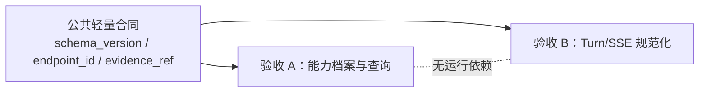
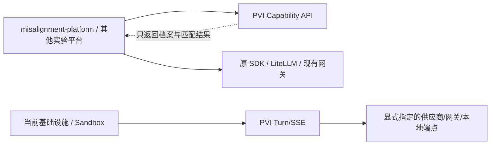
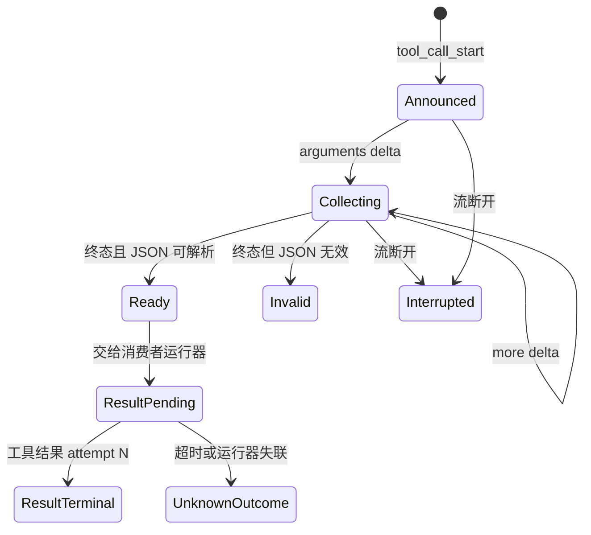
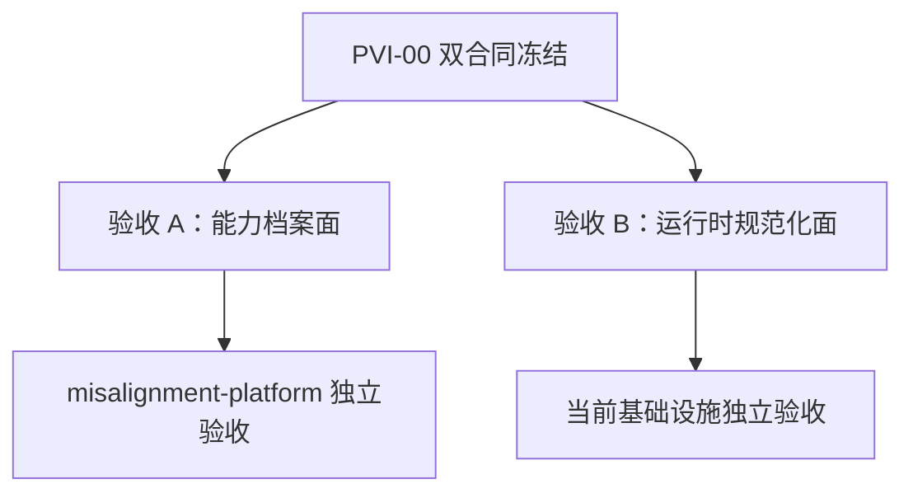
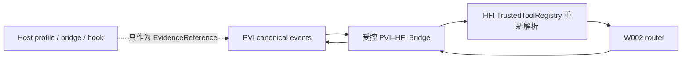

# PVI-00：供应商能力、信任、调用与规范化平台正式交接文档

> **历史交接与设计背景，非当前实现说明。** 当前 v0.5.x 架构与规划分别见根目录
> [`PROJECT_STRUCTURE.md`](../../../PROJECT_STRUCTURE.md) 与 [`ROADMAP.md`](../../../ROADMAP.md)。本文含有尚未实现的
> 验收 B Runtime 与早期工作流，不能据此宣称其已完成。

> 文档状态：正式设计交接版
> 文档版本：1.2（Host 证据泛化、PVI–HFI Bridge Annex）
> 日期：2026-07-19
> 适用阶段：PVI-00 Contract Freeze 与后续独立实施
> 目标读者：没有本项目背景、没有多模型 API、沙箱、SSE 或消息队列经验的外部实施人员
> 硬隔离：PVI 是独立项目，不得读取、修改、依赖或复用 `inspect_test` 的 router、文件后端、receipt、测试、依赖或 git 状态。

---

## 0. 如何使用本交接文档

本文件是外部人员接手 PVI 项目时的唯一主入口。实施者不应依赖口头背景，也不需要了解当前任何业务项目。

文中的规范词含义如下：

- **必须**：属于验收合同，缺失即不能验收。
- **不得**：明确禁止。
- **应当**：强烈建议；若偏离，必须提交 Architecture Decision Record（ADR）说明理由与风险。
- **可以**：实现选择，由实施者决定。
- **TBD**：只有在目标供应商、网关或模型确定并核对官方文档后才能填写，不得猜测。

本交接包区分三类内容：

| 类型 | 是否冻结 | 例子 |
|---|---:|---|
| 验收 A 合同 | 是 | Capability Profile、端点分类、能力查询与证据引用 |
| 验收 B 合同 | 是 | 最小 Canonical JSON、Turn/SSE、工具关联与规范化错误 |
| 实现技术 | 否 | 语言、框架、数据库、是否复用 LiteLLM/Portkey/Bifrost |

---

## 1. 一页式结论

PVI 的正式定位是：

> 面向沙箱、实验平台和其他项目的供应商能力、端点信任、统一调用与事件规范化共享基础设施。

PVI 有两个**并行且可独立验收**的使用面：

1. **验收 A：能力档案面。** 为 `misalignment-platform` 等实验平台描述端点/模型的能力边界，返回候选、未知项和证据；消费者继续使用原 SDK、LiteLLM 或网关调用模型。
2. **验收 B：运行时规范化面。** 为当前基础设施提供最小 Turn/SSE 与 canonical 事件，把实际供应商响应规范化后交给消费者。

两者共享 `schema_version`、`endpoint_id` 和少量证据引用类型，但不得形成运行依赖：

- 验收 A 不要求部署 Turn/SSE，不要求存在供应商 adapter；
- 验收 B 不要求 Capability Registry 在线，Turn 可以直接指定已配置的 `endpoint_id`；
- 任一验收面失败不得阻塞另一验收面的测试、部署或交付；
- 只有公共 Schema 发生不兼容变更时，才按版本管理处理，而不是让两个服务互相等待。



PVI 不是：

- 一个新的通用 LLM Gateway 产品；
- LiteLLM、Portkey 或 Bifrost 的替代品；
- MCP Server、MCP 商城或完整 MCP Host；
- Skill 商城、Skill 执行器或 Skill 分发平台；
- 业务工具执行器；
- Agent 工作流编排平台；
- Claude Code sandbox 专属插件；
- `inspect_test` 的子模块。

首期只需两块可独立启动的轻量组件：能力档案可先由版本化 JSON 文件加只读 HTTP 查询实现；运行时规范化使用 HTTP/JSON 创建 Turn、SSE 输出事件。首期明确不要求消息队列、durable outbox、自动路由、自动 failover、策略引擎、管理后台或完整事件仓库。

---

## 2. 背景与问题定义

各模型供应商虽然都能生成文本，部分也能提出工具调用，但不存在覆盖 OpenAI、Anthropic、Gemini、聚合网关和本地开源模型的完整统一线协议。

常见差异包括：

- 消息角色、内容块和指令优先级不同；
- 工具调用可能是原生结构化对象，也可能只是文本模拟的 JSON/XML/Markdown；
- 工具参数可能一次性返回，也可能作为 JSON 字符串半包流式到达；
- 同一 assistant turn 可能提出零个、一个或多个工具调用；
- call ID、finish reason、usage、错误和重连语义不同；
- reasoning 可能不可见、只有 token 统计、只有摘要、提供可见文本，或仅提供不透明续接 artifact；
- OpenAI-compatible 可能只表示 SDK 或字段外形兼容，不能证明语义完整保留；
- 同一模型经官方 API、云托管、聚合网关和本地推理运行时暴露的能力不同；
- MCP、Skill、工具审批和文件权限主要属于消费者运行器，而非基础模型本体。

因此，不能只维护“某模型支持工具调用”这样的布尔表。能力结论必须限定到：

```text
端点 + API Surface + API 版本 + 请求模型 + 报告模型 + 模型修订
+ 部署/区域 + 相关配置摘要 + Probe 版本 + 观察时间
```

---

## 3. 目标消费者与系统边界

### 3.1 消费者

PVI 首版只以两个消费者作为验收对象：

- `misalignment-platform`：只接能力档案面，保留原调用路径；
- 当前项目基础设施：只接运行时规范化面，使用 Turn/SSE。

其他沙箱、业务项目和本地开源模型环境是合同设计时的兼容性考虑，不是首期额外验收对象，也不得据此增加 UI、路由器或专用工作流。

### 3.2 两条独立调用关系



实验平台只向能力档案面查询并记录 profile 版本，模型请求仍由自己的原路径发出。当前基础设施才通过运行时面创建 Turn、读取 canonical events，并回传由消费者执行的工具结果。二者不是前后迁移阶段，也不要求同一个消费者最终同时使用。

PVI 可以接收消费者提交的脱敏 bridge/hook/session evidence，但不得依赖任何特定沙箱的内部数据库、文件格式或私有事件类型。

### 3.3 三层能力模型

| 层级 | 典型能力 | 归属 |
|---|---|---|
| 模型/API | 原生工具调用、结构化输出、reasoning 暴露、上下文、logprobs | 模型与供应商 API |
| 端点/网关 | 协议转换、路由、重试、usage、模型披露、数据治理 | 端点运营者或网关 |
| 运行器 | MCP Client、Skill、审批、业务工具、文件权限、沙箱策略 | Claude Code、实验平台或其他消费者 |

不得把运行器支持 Skill 或 MCP 记成基础模型的原生能力。

### 3.4 初学者术语

| 术语 | 简单解释 |
|---|---|
| Endpoint | 一个实际可以连接的模型入口；同一模型可以有多个 Endpoint。 |
| Adapter | 把某种供应商/网关协议翻译为 PVI 合同的模块。 |
| Turn | 一轮模型交互；可能先产生工具调用，收到工具结果后才最终完成。 |
| SSE | 基于 HTTP 的单向事件流；服务端按顺序持续向客户端发送事件。 |
| Canonical | PVI 自己定义的供应商无关统一对象。 |
| Probe | 针对某项接口能力的可重复测试，不等同于模型质量评测。 |
| Evidence | 支持某个结论的脱敏文档、响应、事件或测试记录。 |
| MCP | 运行器连接外部 Tools、Resources、Prompts 的协议，不是基础模型线协议。 |
| Skill | 运行器加载的指令、资源、脚本或工作流能力包，不是模型原生能力。 |

---

## 4. 现有工作与复用调研要求

### 4.1 已发现的候选类别

现有生态已经提供若干可复用组件：

| 类别 | 候选 | 可参考或复用的能力 |
|---|---|---|
| 通用模型网关 | LiteLLM、Portkey、Bifrost 等 | 多供应商连接、兼容 API、路由、限流、预算、费用、观测 |
| 模型目录 | LiteLLM Model Catalog 等 | 模型名称、价格、上下文窗口、部分声明能力 |
| MCP 测试 | 官方 MCP Inspector | 外部 MCP Server 的交互测试与调试 |
| 本地推理 | vLLM、SGLang、llama.cpp、Ollama 等 | 本地模型服务、部分 OpenAI-compatible API、logprobs/logits 或运行时控制 |

参考资料：

- [LiteLLM](https://docs.litellm.ai/)
- [LiteLLM Model Catalog](https://api.litellm.ai/docs)
- [Portkey AI Gateway](https://portkey.ai/docs/product/ai-gateway)
- [Bifrost](https://docs.getbifrost.ai/providers/supported-providers/overview)
- [MCP Inspector](https://modelcontextprotocol.io/docs/tools/inspector)

这些项目不能自动替代 PVI 的能力档案、证据、Probe verdict 和 canonical contract，但实施者可以复用其中适合的部分。

### 4.2 本文不替实施者选择仓库

实施者必须自行调研并决定：

- 直接使用原生 adapter；
- 在 PVI 后接通用网关；
- 嵌入某个网关库；
- 混合使用；
- 完全不复用某候选项目。

不得只凭 star 数或支持供应商数量作选择。

### 4.3 统一调研维度

每个候选必须记录：

```text
许可证与商业限制
维护活跃度和升级风险
支持的供应商与 API Surface
原生协议与 OpenAI-compatible 支持
流式事件保真度
工具、多工具、reasoning、usage 支持
本地模型与 logprobs/logits 支持
原始证据可得性
自定义 adapter 难度
认证、限流、预算和审计
离线部署能力
对 PVI canonical contract 的影响
退出和替换方案
```

### 4.4 强制 ADR

编码前必须交付 `ADR-REUSE-001.md`，说明选择或不选择的理由、复用边界、许可证、维护策略、风险、退出方案和对合同的影响。验收依据是 PVI 对外合同，而不是采用了哪个仓库。

---

## 5. 端点分类与信任分级（冻结 v1）

### 5.1 端点种类

`endpoint_kind` 首版枚举：

```text
official_direct
managed_cloud
broker_gateway
self_hosted_gateway
local_open_weights
local_opaque_runtime
unknown
```

定义：

| 类型 | 含义 |
|---|---|
| `official_direct` | 模型发布方直接提供的官方 API |
| `managed_cloud` | 云厂商托管、转售或部署入口 |
| `broker_gateway` | 第三方聚合、中转或统一计费入口 |
| `self_hosted_gateway` | 由使用组织自行部署和治理的转发层 |
| `local_open_weights` | 权重、tokenizer 和推理配置可识别的本地模型 |
| `local_opaque_runtime` | 在本地运行，但模型、权重或推理实现不透明 |
| `unknown` | 证据不足，无法可靠归类 |

平台名称不得硬编码为高可信或低可信。OpenRouter、yunwuapi 或其他平台首先登记为待审核端点，再按证据赋级。

### 5.2 信任信息不合成单一分数

首版三个核心维度必须记录；另外两个维度可以记录，缺失时为 `unknown`：

```text
核心：identity_assurance / model_provenance_assurance / protocol_fidelity_assurance
可选：data_handling_assurance / operational_assurance
```

保障状态首版枚举：

```text
verified
governed
declared_unverified
unknown
failed
```

这些维度不得合成一个模糊的“可信分数”。例如，某网关运营主体可以核验，但协议转换仍可能是 lossy；某本地模型数据不出机，但权重来源可能未知。

### 5.3 协议保真等级

`protocol_fidelity`：

```text
native
documented_translation
observed_translation
lossy_translation
unknown
```

### 5.4 使用限制的边界

PVI 记录事实和未知项，不承担消费者的审批、数据分级或工具授权。Endpoint Profile 可以包含简短的 `usage_notes[]`，例如“模型身份仅由网关声明”或“工具参数流尚未验证”，但首期不得设计 `max_data_classification`、人工审批流、自动工具授权或 fallback 策略引擎。消费者根据自己的环境决定是否使用。

---

## 6. Capability Profile Contract（冻结 v1）

### 6.1 作用域与身份

每份档案必须绑定：

```text
endpoint_id
endpoint_kind
provider_id
api_surface
api_version
model_requested
model_reported
model_revision
deployment_id
region
relevant_configuration_digest
observed_at
```

模型 alias、请求模型和响应报告模型必须分开保存；不得因为名字相似就推断真实上游。

### 6.2 结论状态

能力状态固定为：

```text
supported
unsupported
unknown
not_tested
not_applicable
inconclusive
```

每项能力同时保留：

- `advertised`：官方、网关或模型目录声明；
- `observed`：受控 Probe 结果；
- `effective`：结合策略后，对消费者实际可用的结果。

### 6.3 能力领域

首版至少覆盖：

- 消息角色与富内容；
- 多模态输入输出；
- Structured Output；
- 工具调用表示；
- 工具参数流；
- 多工具与并行工具；
- call/result 关联；
- reasoning 暴露和续接；
- usage 和上下文限制；
- 流式、取消与恢复；
- sampling 控制；
- logprobs、full logits、权重与 tokenizer；
- 供应商/网关内建工具；
- 网关重试、路由和模型披露。

### 6.4 工具调用表示

`tool_call_representation`：

```text
native_structured
native_structured_streaming
json_text_simulation
xml_text_simulation
markdown_text_simulation
provider_builtin
gateway_builtin
unsupported
unknown
```

文本模拟不得被标记为原生结构化调用。缺少稳定 ID、可靠终态和结果关联时，默认不得进入自动执行链。

### 6.5 Reasoning 暴露

`reasoning_exposure`：

```text
none
token_usage_only
summary_only
visible_reasoning_text
opaque_continuation_artifact
mixed
unknown
```

PVI 的目标是记录供应商实际暴露的 reasoning 形态和续接条件，不以获取完整内部 chain-of-thought 为目标。

### 6.6 Sampling 与概率可观测性

```text
sample_only
seed_control
decoding_controls
top_k_logprobs
full_vocab_logits
local_weights_and_runtime
unknown
```

有限重复采样不能宣称恢复了完整概率分布。

### 6.7 Capability Profile 最小 JSON

以下是结构示例；正式实施必须提供 JSON Schema Draft 2020-12：

```json
{
  "schema_version": "pvi.capability-profile/v1",
  "profile_id": "cap-profile-opaque-id",
  "subject": {
    "endpoint_id": "endpoint-opaque-id",
    "endpoint_kind": "official_direct",
    "provider_id": "provider-placeholder",
    "api_surface": "native_api",
    "api_version": "version-or-unknown",
    "model_requested": "model-alias-or-id",
    "model_reported": "model-id-or-null",
    "model_revision": "revision-or-unknown",
    "deployment_id": null,
    "region": null,
    "relevant_configuration_digest": "sha256-placeholder",
    "observed_at": "2026-07-19T00:00:00Z"
  },
  "assurance": {
    "identity_assurance": "verified",
    "data_handling_assurance": "declared_unverified",
    "model_provenance_assurance": "verified",
    "protocol_fidelity_assurance": "verified",
    "operational_assurance": "unknown",
    "protocol_fidelity": "native",
    "usage_notes": []
  },
  "model_api_capabilities": {
    "tool_calling": {
      "advertised": "supported",
      "observed": "not_tested",
      "effective": "not_tested",
      "representation": "unknown",
      "streaming_arguments": "unknown",
      "multiple_calls_per_turn": "unknown",
      "stable_call_result_correlation": "unknown",
      "native_tool_result_continuation": "unknown",
      "evidence_ids": []
    },
    "reasoning": {
      "advertised": "unknown",
      "observed": "not_tested",
      "effective": "not_tested",
      "exposure": "unknown",
      "continuation_artifact": "unknown",
      "evidence_ids": []
    },
    "sampling_observability": {
      "observed": "not_tested",
      "seed_control": "unknown",
      "decoding_controls": "unknown",
      "top_k_logprobs": "unknown",
      "full_vocab_logits": "unknown",
      "local_weights_access": "unknown",
      "evidence_ids": []
    }
  },
  "endpoint_capabilities": {
    "stream_transport": "unknown",
    "usage_reporting": "unknown",
    "routing_transparency": "not_applicable",
    "fallback_behavior": "unknown",
    "raw_evidence_availability": "unknown"
  },
  "runtime_interop": {
    "mcp_client": "external_runtime_managed",
    "skills": "external_runtime_managed",
    "tool_execution": "consumer_managed",
    "sandbox_evidence_adapter": "not_configured"
  },
  "probe_summary": {
    "probe_suite_version": "pvi-probe-suite/v1",
    "completed_probe_ids": [],
    "inconclusive_probe_ids": [],
    "next_revalidation_due": null
  }
}
```

---

## 7. Probe 与证据体系（冻结 v1）

### 7.1 Probe 的边界

Probe 验证接口和能力行为，不用于评价模型的通用智力。设计阶段只定义 Probe 和脱敏 fixture；在获得明确授权、凭证治理和费用策略前不得发送真实请求。

### 7.2 Probe Catalog

首版至少定义：

```text
text_message_probe
role_support_probe
multimodal_content_probe
structured_output_probe
native_tool_call_probe
text_simulated_tool_probe
multiple_tool_call_probe
streaming_arguments_probe
invalid_json_probe
stream_interruption_probe
tool_result_correlation_probe
reasoning_exposure_probe
continuation_artifact_probe
usage_probe
seed_repeatability_probe
logprobs_probe
full_logits_probe
unknown_event_probe
gateway_fidelity_probe
```

### 7.3 Probe Run

每次运行必须记录：

```text
probe_run_id
probe_id
probe_version
subject_profile_id
input_digest
configuration_digest
environment_digest
started_at
completed_at
verdict
evidence_ids
normalization_error_ids
```

`verdict` 使用：

```text
observed_supported
observed_unsupported
inconclusive
not_applicable
aborted
```

### 7.4 EvidenceReference

最小字段：

```text
evidence_id: string
source_kind: official_document | provider_native | managed_cloud |
             broker_gateway | local_runtime | host_bridge |
             host_hook | session_export | operator_note | unknown
host_profile_id: string | null
capture_surface: provider_wire | gateway_wire | host_normalized_event |
                 host_session_record | hook_callback | exported_transcript |
                 operator_observation | unknown
sha256: string | null
media_type: string
redaction_profile: string
locator: string | null
captured_at: RFC3339 timestamp
retention_class: ephemeral | standard | restricted | metadata_only
```

`host_profile_id` 是不透明的 Host Profile 引用，不是固定枚举。Claude Code、Codex、OpenCode、Qoder 或未来其他运行器只登记为不同 profile 值；新增 Host 不得新增 `source_kind`，也不得因此升级 Schema major。`capture_surface` 只描述证据在链路哪一层被观察，不承诺该表面能看到供应商原始流、usage、隐藏 reasoning 或供应商 call ID。

PVI-00 只要求证据能够被引用，不要求建设独立证据仓库，也不强制实验平台提交原始样本。实现可以保存完整内容、保存摘要/digest，或只引用消费者已有记录；选择由部署方决定并写入配置。无论选择哪种方式，凭证和敏感 header 都不得进入 fixture、canonical event 或普通日志。

digest 仅用于复核内容或配置是否一致，不是加密，也不是验收 A/B 的必填字段。

### 7.5 结论更新规则

- 官方声明只能更新 `advertised`，不能自动更新 `observed`；
- 受控、有效、证据完整的 Probe 才能更新 `observed`；
- 单次随机失败不直接证明 unsupported；
- API、模型、网关路由、运行时或相关配置变化时，旧结论必须失效或重新验证；
- 网关观察不能替代官方原生端点的能力结论；
- `unknown`、`not_tested` 和 `inconclusive` 不得转写为支持。

---

## 8. Canonical Event Contract（仅验收 B，冻结 v1）

验收 A 到第 7 章即已拥有完整能力档案合同，不读取也不生成本章对象。本章只服务于当前基础设施的运行时规范化；保留这些对象是因为验收 B 确实需要跨供应商表达文本、工具调用、usage 和结束状态，而不是为了让实验平台迁移调用链。

### 8.1 公共规则

所有 canonical 对象必须包含：

```text
schema_version: "pvi.canonical/v1"
evidence: EvidenceReference[]
normalization: NormalizationMeta
```

`NormalizationMeta.overall_fidelity`：

```text
exact
lossy
unknown
unsupported
synthetic
```

每个非 exact 映射必须在 `annotations[]` 中记录 `field_path`、状态、原因码和证据引用。

### 8.2 CanonicalMessage

最小字段：

```text
message_id
session_id
turn_id
role: system | developer | user | assistant | tool
ordinal_in_turn
content: ContentPart[]
tool_call_ids: string[]
tool_result_ids: string[]
origin: caller | provider | gateway | runtime | synthetic
provider_model
```

`ContentPart.type` 首版支持：

```text
text
json
image_reference
audio_reference
file_reference
data_reference
citation
refusal
unknown_reference
```

内容顺序必须保留；拒绝、引用、工具调用和 reasoning 不得强行压成普通文本。

### 8.3 CanonicalToolDefinition

最小字段：

```text
toolset_id
tool_definition_id
name
description
input_schema
output_schema
tool_origin: application | mcp | provider_builtin | gateway_builtin | unknown
execution_owner: consumer_runtime | mcp_server | provider | gateway | unknown
side_effect_class: read_only | idempotent | non_idempotent | unknown
approval_policy: preapproved | requires_user_approval | prohibited | unknown
catalog_snapshot_id
execution_contract_ref: {contract_id, contract_version} | null
```

工具描述和 MCP annotations 必须视为不可信输入，除非来自已审核来源。`CanonicalToolDefinition` 和 `execution_contract_ref` 都只是声明与关联信息，不构成执行授权；任何消费者执行器仍必须在自己的可信注册表中重新解析并完成 gate。

### 8.4 CanonicalToolCall

最小字段：

```text
call_id
session_id
turn_id
assistant_message_id
ordinal_in_assistant_turn
tool_definition_id
tool_name
arguments_json
arguments_state: complete | invalid_json | incomplete | missing | unknown
lifecycle_status: ready | invalid | interrupted | cancelled | unknown
retry_of_call_id
```

关键不变量：

1. `call_id` 是不透明、稳定、全 session 唯一的字符串；
2. 多调用顺序由 `ordinal_in_assistant_turn` 固化；
3. 只有 complete + ready 才可交给消费者运行器；
4. 半包或无效 JSON 不得自行补全；
5. 同 ID 冲突必须产生 normalization error；
6. 看起来相同的新调用默认仍是新调用；
7. 不得为悬空结果伪造 call。

### 8.5 CanonicalToolResult

最小字段：

```text
tool_result_id
call_id
execution_attempt
status: success | denied | error | cancelled | timeout | unknown
is_terminal
content: ContentPart[]
structured_output
replay_safety: not_replayed | safe_idempotent_replay |
               explicitly_authorized_replay | unsafe_or_unknown
```

每个 `(call_id, execution_attempt)` 最多一个终态结果。网关重试、HTTP 重传和工具实际重试必须区分。

### 8.6 CanonicalCompletion

最小字段：

```text
completion_id
session_id
turn_id
assistant_message_id
tool_call_ids
status: complete | partial | interrupted | error
finish_reason: stop | tool_calls | length | content_filter |
               cancelled | error | unknown
usage
reasoning_sidecar
provider_model
```

未知原始 finish reason 必须映射为 `unknown`，并保留原始证据；不得默认当作 stop。

### 8.7 ReasoningSidecar

最小字段：

```text
availability: absent | withheld | token_usage_only | summary |
              visible_text | opaque_continuation | mixed | unknown
visibility: user_visible | runtime_only | unavailable
summary_reference
continuation_reference
continuation_binding: provider_route_bound | session_bound | none | unknown
retention_policy: none | ephemeral | approved_summary_only | restricted
```

Continuation artifact 不得跨供应商、模型、路由或不兼容会话使用。

### 8.8 CanonicalStreamEvent

最小字段：

```text
event_id
stream_id
sequence
type: message_start | text_delta | reasoning_delta | tool_call_start |
      tool_arguments_delta | tool_call_finalized | usage_update |
      completion | normalization_error | stream_interrupted
related_message_id
related_call_id
payload
```

同一 stream 的 sequence 严格递增。参数 delta 只表示分片，不表示可执行 JSON。

### 8.9 CanonicalNormalizationError

最小字段：

```text
error_id
scope_kind
scope_id
stage: capture | decode | mapping | stream_reassembly |
       association | validation
code
recoverability: recoverable | terminal | unknown
safe_summary
```

首版错误码至少包括：

```text
invalid_tool_arguments_json
incomplete_tool_arguments_stream
duplicate_call_id_conflict
orphan_tool_result
ambiguous_call_result_association
out_of_order_stream_event
gateway_semantic_loss
usage_unavailable
reasoning_unavailable
continuation_binding_lost
unsupported_source_semantic
```

---

## 9. 工具调用状态机（仅验收 B）

上一章已经定义了“工具调用对象里有什么字段”，但字段本身不足以回答“此刻能不能执行工具”。本章把一条工具调用在流式传输和消费者执行之间的**允许动作顺序**固定下来。它约束的是 PVI 与消费者运行器的协议行为，不是在描述模型的内部思考过程。

最直观的理解是：模型先说“我要调用哪个工具”，随后才可能分片给出参数；只有参数已完整到达且能解析为合法 JSON 时，消费者才可执行。执行后还要把结果精确回传给原 call。任何中断、无效参数或执行结果不明，都不能被系统悄悄当作一次成功调用。



| 状态 | 人话含义 | 此时允许的动作 | 禁止的动作 |
|---|---|---|---|
| `Announced` | 已收到工具名或 call ID，但参数可能还没开始 | 建立关联、等待参数 | 执行工具 |
| `Collecting` | 正在接收流式参数碎片 | 缓存、重组、校验顺序 | 把半截 JSON 当参数执行 |
| `Ready` | 已收到终态，且参数 JSON 合法 | 交给声明的消费者运行器 | 修改参数、猜测缺失字段 |
| `Invalid` | 流已结束但参数不是合法 JSON | 发出规范化错误、等待上层处理 | 自动“修复”后执行 |
| `Interrupted` | 参数尚未完成时流断开 | 记录中断与证据 | 继续执行或猜测完成内容 |
| `ResultPending` | 工具已交给运行器，等待其回传结果 | 等待、超时管理、按幂等键接收回传 | 未确认安全性就重放 |
| `ResultTerminal` | 已收到某个 attempt 的终态结果 | 继续下一轮模型交互或结束 | 将同一 attempt 再记为新执行 |
| `UnknownOutcome` | 运行器失联/超时，无法判断工具是否已产生副作用 | 标记不确定、请求人工决策 | 自动再次执行非幂等工具 |

例子：流里先到达 `{"city":"Bei`，后到达 `jing"}`。它们只能构成 `Collecting`，不能调用天气工具；合并并验证为 JSON 后才进入 `Ready`。如果第二个分片没来就断线，则进入 `Interrupted`，不会把 `Bei` 猜成 `Beijing`。若工具已被执行但运行器在回传前断线，则是 `UnknownOutcome`，尤其对“发邮件、写文件、扣费”类工具不得自动再跑一次。

收到工具参数 delta 时只能缓存，不得执行。网络重传同一工具结果时应幂等返回第一次接受结果，不得自动创建新 attempt。对于 `non_idempotent` 或 `unknown` 工具，除非有明确人工授权和可证明的幂等键，否则禁止自动重放。

状态机确定“什么时候能执行、什么时候必须停下”，下一章才把这些动作暴露为 HTTP/SSE API：`tool_call_finalized` 对应从 `Collecting` 到 `Ready`，`POST /tool-results` 对应从 `ResultPending` 到终态或不确定状态。

---

## 10. 对外 API（按验收面分别冻结 v1）

本章包含两组互不依赖的 API。10.2 属于验收 A；10.3—10.5 属于验收 B。实现可以放在同一进程，也可以是两个服务，但验收测试必须能够分别运行。

### 10.1 通用约定

- JSON 使用 UTF-8；
- API 路径版本为 `/v1`；
- Canonical Schema 版本独立为 `pvi.canonical/v1`；
- 所有 ID 都是不透明字符串；
- 时间使用 RFC 3339 UTC；
- 写操作必须支持 `client_request_id` 或等价幂等键；
- 凭证不得出现在请求体、响应体或 canonical event；
- 能力面只返回候选和理由，不替消费者自动发起调用；
- 运行时面只使用请求中明确指定的端点，不自动改选端点。

### 10.2 验收 A：能力档案接口

| 方法 | 路径 | 用途 |
|---|---|---|
| `GET` | `/v1/endpoints` | 查询已登记端点 |
| `GET` | `/v1/endpoints/{endpoint_id}` | 读取端点、保障维度与使用策略 |
| `GET` | `/v1/capability-profiles` | 查询能力档案 |
| `GET` | `/v1/capability-profiles/{profile_id}` | 读取完整能力档案 |
| `POST` | `/v1/capability-queries:resolve` | 按能力与信任条件解析候选端点 |
| `GET` | `/v1/probes` | 查询 Probe 定义；可由静态文件提供 |
| `GET` | `/v1/probe-runs/{run_id}` | 查询已有 Probe 结果；首期不要求在线 Probe Runner |
| `GET` | `/v1/evidence/{evidence_id}` | 读取证据引用；首期不要求托管原始内容 |

Capability Query 示例：

```json
{
  "model": "requested-model-name",
  "requirements": {
    "tool_calling": "native_structured",
    "reasoning_exposure": ["summary_only", "visible_reasoning_text"]
  }
}
```

Resolution 结果必须返回候选 profile、满足项、不满足项、未知项和证据引用，不得只返回一个模型名。首期不要求策略引擎、价格排序、自动调用或人工审批工作流。

为满足“免于复杂配置”，验收 A 必须同时提供简单路径：消费者只给已有的 `profile_id`，或只按 `model + endpoint_id` 查询完整档案；`requirements` 高级匹配是可选能力。`misalignment-platform` 不需要复制端点信任字段、Probe 配置或供应商凭证，只需把使用时的 `profile_id + profile_version` 写进自己的 run provenance。

### 10.3 验收 B：创建模型 Turn

本节冻结 PVI 通用运行时接口，不直接引用 HFI W001/W002 类型。当前基础设施的工具执行必须经过文末独立的 **PVI–HFI Bridge Annex**；该 Annex 是双方唯一共享边界，Host、供应商和 HFI 内部对象不得直接进入本 API。

`POST /v1/turns`

```json
{
  "client_request_id": "req-demo-0001",
  "session_id": "session-demo-0001",
  "endpoint_id": "endpoint-preconfigured-0001",
  "capability_profile_id": null,
  "stream": true,
  "messages": [
    {
      "message_id": "msg-user-001",
      "role": "user",
      "content": [{"type": "text", "text": "查询演示记录"}]
    }
  ],
  "tools": [
    {
      "tool_definition_id": "tool-read-record-v1",
      "name": "read_record",
      "description": "读取一个已授权的演示记录。",
      "input_schema": {
        "type": "object",
        "properties": {"record_id": {"type": "string"}},
        "required": ["record_id"],
        "additionalProperties": false
      },
      "tool_origin": "application",
      "execution_owner": "consumer_runtime",
      "side_effect_class": "read_only"
    }
  ]
}
```

接受响应：

```json
{
  "turn_id": "turn-demo-0001",
  "session_id": "session-demo-0001",
  "status": "accepted",
  "events_url": "/v1/turns/turn-demo-0001/events",
  "schema_version": "pvi.canonical/v1"
}
```

`202 Accepted` 只表示请求被接受，不表示模型已经完成。

### 10.3.1 两个并行验收面，而非迁移阶段

两个验收面服务于不同消费者，不构成“先做 A、再迁移到 B”的路线。

| 验收面 | 请求实际由谁发给供应商/网关 | PVI 看见什么 | 能得到什么 | 目标消费者 |
|---|---|---|---|---|
| **验收 A：能力档案接入** | 实验平台沿用自己的 SDK、LiteLLM 或现有网关调用 | Capability Query、档案版本及可选证据引用 | 能力边界判断与实验 provenance；不提供 canonical stream | `misalignment-platform` 等不确定复现实验 |
| **验收 B：统一调用接入** | PVI Runtime Adapter 调用请求明确指定的端点 | 本次请求、供应商响应和规范化事件 | 统一 SSE、工具 ID 关联、参数半包处理、usage/finish reason 规范化 | 当前基础设施 |

因此，“保留原调用路径”不是 PVI 复制或保留原始调用，而是**实验平台的调用代码继续直接访问供应商**；PVI 只提供选择和记录能力。另一边，当前基础设施从一开始就可以使用 `/v1/turns` 与 `/events`，PVI 在该链路中规范化请求与响应。是否长期保存正文属于部署配置，不影响两条验收合同。

验收 B 中 `capability_profile_id` 是可选的 provenance 字段。没有部署验收 A 服务时，只要 `endpoint_id` 已在运行时本地配置，Turn 仍须正常工作。两种模式产生的记录必须标记 `invocation_mode: consumer_direct | pvi_managed`，避免把消费者自报观察误当成 PVI 全链路观察。

### 10.4 Turn 与事件接口

| 方法 | 路径 | 用途 |
|---|---|---|
| `GET` | `/v1/turns/{turn_id}` | 查询 turn 状态 |
| `GET` | `/v1/turns/{turn_id}/events` | 读取 SSE canonical events |
| `POST` | `/v1/turns/{turn_id}/tool-results` | 消费者回传工具结果 |
| `POST` | `/v1/turns/{turn_id}:cancel` | 可选；请求取消 turn |

首期 SSE 必须保证单连接内 `sequence` 递增并发送明确终态。只有实现了事件持久化时才要求 `Last-Event-ID` 恢复；未实现恢复时必须在 OpenAPI 中明确声明，不得假装断线续传成功。

### 10.5 工具结果回传

```json
{
  "tool_results": [
    {
      "tool_result_id": "result-001-attempt-1",
      "call_id": "call-001",
      "execution_attempt": 1,
      "status": "success",
      "is_terminal": true,
      "content": [{"type": "text", "text": "演示结果"}],
      "structured_output": {"record_id": "demo-42"},
      "replay_safety": "not_replayed"
    }
  ]
}
```

服务必须校验 `turn_id + call_id + execution_attempt`，不得猜测关联。

### 10.6 可选证据接入

| 方法 | 路径 | 用途 |
|---|---|---|
| `POST` | `/v1/observations:ingest` | 接收 sandbox/bridge/hook 的脱敏观察 |
| `POST` | `/v1/evidence:register` | 注册离线证据摘要和引用 |

Evidence Adapter 不得根据 `host_profile_id` 推断某类 Host 一定能看到供应商原始流、usage、隐藏推理或供应商 call ID。只能按 `capture_surface` 和实际证据记录；不可见即记录 unavailable/unknown。

---

## 11. 显式端点与最小重试边界

为避免 PVI 变成另一个复杂网关，首期职责按验收面分开：

- 验收 A 可以返回多个候选及理由，但不自动选择、路由或调用；
- 验收 B 必须使用 Turn 中的显式 `endpoint_id`，不查询能力服务、不根据价格或健康度改选；
- 自动跨端点 failover 不属于 PVI-00；
- 请求重试默认关闭。只有尚未产生任何消费者可见事件、adapter 明确证明安全且复用同一 `client_request_id` 时，才可由部署方显式开启传输级重试；
- 已提出工具调用或可能产生外部副作用后，不得由 PVI 自动重放。

### 11.1 中转端点的最小附加记录

中转网关必须额外记录：

```text
gateway_id
upstream_vendor_declared
requested_model
reported_model
routing_observation: observed | declared_only | unknown
translation_fidelity
fallback_behavior: declared_value | unknown
```

“OpenAI-compatible”不能自动被标记为 exact。

---

## 12. Adapter 合同（仅验收 B）

验收 A 的能力档案可以人工维护或由离线脚本生成，不要求 provider adapter。验收 B 的每个 runtime adapter 只需提供三项等价能力：

```text
encode_request(canonical_request) -> ProviderRequestEvidence
consume_and_normalize(provider_response_or_stream) -> CanonicalStreamEvent[]
encode_tool_results(canonical_results) -> ProviderResumeRequest
```

若首个验收目标不涉及工具结果续接，可以暂不实现 `encode_tool_results`，但必须把该 adapter 的对应能力标为 `unsupported`，不能用文本拼接伪装支持。

每个 runtime adapter manifest 还必须声明：

```text
tool_result_continuation: native | text_only | unsupported
```

只有 `native` 且通过 call/result correlation fixture 的 adapter 才可用于 PVI–HFI 工具闭环。`text_only` 表示只能把工具结果拼入普通文本上下文，不是原生 tool-result continuation；它和 `unsupported` 都不得开启 HFI 工具执行路径。

Adapter 类型按真实端点按需增加，不要求首期全部实现：

```text
native_provider_adapter
managed_cloud_adapter
broker_gateway_adapter
local_runtime_adapter
```

Adapter 不得：猜测字段、补全无效 JSON、把未知 finish reason 当 stop、自动执行工具、隐藏网关转换、把请求模型名当真实执行模型，或静默丢弃不支持事件。

Provider runtime adapter 只负责“供应商协议 ↔ PVI canonical”。“PVI canonical ↔ HFI”由独立受控 bridge 负责，两者不得合并为一个读取 HFI 内部实现的 adapter。具体门禁、ID 关联和零调用负向规则见 PVI–HFI Bridge Annex。

---

## 13. 本地开源模型兼容预留（非首期验收）

未来纳入本地开源模型时，身份建议记录：

```text
weight_digest
tokenizer_digest
model_config_digest
quantization
runtime_name
runtime_version
hardware
decoding_implementation
```

届时 Probe 应区分：经验采样、seed 可重复性、temperature/top-p/top-k 控制、top-k logprobs、full-vocabulary logits、权重与运行时可得性。量化、tokenizer 或推理运行时变化后，旧概率观察不得直接复用。本章只保证 Capability Profile 枚举不堵死该扩展，不要求首期实现本地运行时 adapter 或概率 Probe。

---

## 14. MCP、Skill 与工具执行边界

### 14.1 MCP

MCP Client、授权、Server 管理、Tools/Resources/Prompts 暴露和工具执行属于消费者运行器。PVI 首期不启动或托管 MCP Server，也不建设 MCP 商城。

PVI 只记录和规范化：

```text
tool_origin = mcp
execution_owner = mcp_server | consumer_runtime
mcp_server_reference
mcp_tool_reference
catalog_revision
result_evidence
```

若供应商 API 自己提供 MCP connector，应记录为 endpoint capability，不能据此宣称基础模型原生支持 MCP。

可以复用 MCP Inspector 测试外部 MCP Server，并把脱敏结果注册为 PVI evidence；不得自行重复实现 Inspector。

### 14.2 Skill

Skill 属于 harness/runtime。PVI 不创建、下载、分发、审核或执行 Skill，也不建设 Skill 商城。

PVI 只在消费者需要时记录：

```text
skill_runtime_owner
skill_digest_or_reference
loaded_for_turn
allowed_tool_ids
instruction_provenance
```

### 14.3 业务工具

业务工具由消费者运行器执行。PVI 只负责工具定义、调用、结果与证据的规范化和关联，不取得 shell、文件、数据库或外部 SaaS 执行权。

---

## 15. 最小安全与数据约定

PVI-00 不建设通用数据治理平台。验收只固定与模型接入直接相关的最低要求。

所有部署都必须满足：

- 凭证仅通过部署环境 secret reference 注入；
- canonical、日志、fixtures、错误信息不得包含凭证；
- 是否保存完整请求/响应由部署配置决定；实验平台不被强制上传原始样本；
- Prompt、tool result、MCP 描述、Skill 描述视为不可信输入；
- 不记录未经授权的完整隐藏推理；
- 失败不得被记录为成功，未知字段必须保持 unknown/unavailable。

完整内容、摘要、digest 或外部引用都可以使用；PVI 合同不替部署方规定数据敏感等级和保留期。

---

## 16. 最小实现架构

建议使用一个仓库、两个边界清楚的模块；是否同进程部署由实施者决定：

```text
capability/
  版本化 Endpoint / Capability Profile
  只读查询与 resolve

runtime/
  显式 endpoint 配置
  按需 adapter
  Turn / SSE / tool-result normalization

contracts/
  两者共享的 schema_version、endpoint_id、EvidenceReference
```

禁止让 `runtime/` 在请求期间必须调用 `capability/`。可以引用同一个 profile ID，但 profile 服务离线不能导致已配置 endpoint 的 Turn 失败。反向同理，能力查询不得依赖 runtime adapter 或供应商连通。

首期只需要 HTTP/JSON 与 SSE。数据库、消息队列、outbox、自动路由、自动 failover、成本优化、管理 UI 和在线 Probe 调度均不在验收范围；实施者不得仅为“以后可能需要”而加入。

### 16.1 有意暂缓的能力及影响范围

消息队列、自动路由/failover 和复杂策略引擎不进入首期，是经过权衡的范围决定，不是遗漏，也不是宣称它们永远没有价值。它们影响的是规模、高可用和组织级自动化，不影响两个当前验收面的核心功能。

| 暂缓能力 | 对当前验收的影响 | 暂时放弃的效果 | 重新引入的客观触发条件 | 当前保留的扩展接口 |
|---|---|---|---|---|
| 消息队列 / outbox | 验收 A 仍可通过 HTTP 查询档案；验收 B 仍可通过 HTTP 创建 Turn 并用 SSE 接收事件 | 不能承担大规模异步削峰、多个后台消费者、长周期重放；进程在活动 Turn 中崩溃时，本次 Turn 可以失败 | 出现明确的吞吐/背压指标、两个以上独立异步消费者，或必须跨进程可靠重放 | Canonical Event 的 `event_id`、`sequence`；以后可增加发布器而不改变消费者事件结构 |
| 自动路由 / 自动 failover | 能力面照常返回候选；运行时按显式 `endpoint_id` 调用和规范化 | 不会自动按价格、限流、健康度或故障切换端点 | 已有两个以上经过能力与语义验证的可替代端点，并出现明确 SLA、成本优化或容灾要求 | Capability Query 返回候选及理由；Turn 保留显式 `endpoint_id`，未来路由器只负责在调用前生成该选择 |
| 复杂策略引擎 | 能力档案照常描述事实；由消费者决定是否使用端点和工具 | 不提供多租户预算、组织级审批、数据等级矩阵或自动工具授权 | 出现多个团队/租户共享 PVI，且确有集中预算、审批或合规规则需要统一执行 | Profile 的结构化能力结论、信任维度和 `usage_notes[]` 可作为未来策略输入 |

这项取舍对效果的具体判断如下：

- 能力边界判断：不受影响；
- 多供应商 Turn/Stream 规范化：不受影响；
- 复现实验可解释性：显式端点通常更好，因为不会静默切换上游；
- 高并发、故障自动恢复和成本自动优化：首期能力有限；
- 多租户集中治理：首期不提供；
- 实现复杂度、隐式行为和验收风险：明显降低。

不使用消息队列不等于必须丢失所有断线恢复能力。如果验收 B 后续只提出“短时间 SSE 重连”这一项需求，应先增加小型持久化事件日志和 `Last-Event-ID` 恢复；只有出现上述异步分发或背压需求时，才引入消息队列。

任何重新引入都必须由实际指标或已确认的消费者需求触发，并以独立 ADR 说明收益、失败模式和对 A/B 独立验收的影响。不得仅以“以后可能需要”为理由提前实现。

---

## 17. 外部实施工作区与禁止范围

PVI 必须使用独立仓库。建议结构：

```text
pvi/
  README.md
  docs/
  schemas/
  fixtures/
  research/
  decisions/
  adapters/
  probes/
  tests/
```

允许读取：本交接文档（含 PVI–HFI Bridge Annex）、PVI 新目录、脱敏 fixtures、离线官方文档存档、公开候选仓库材料。

禁止读取或修改：

```text
inspect_test/**
inspect_test/.git/**
任何 HFI W001/W002/W003 router、TrustedToolRegistry、文件后端、fd、lease、receipt、测试和依赖
```

设计与离线实施阶段禁止：真实供应商请求、真实凭证、真实用户数据、真实生产日志和业务工具执行。

Bridge Annex 只冻结边界 DTO、不透明 ID、状态映射和验收 fixtures。PVI 外部实施者必须使用 mock HFI port 完成 conformance，不得为了实现 B-05 读取 W001/W002/W003 代码、TrustedToolRegistry、router、fd、lease、receipt 或测试。HFI/W003-B 可以同时对同一 Annex 使用 mock PVI 事件开发，双方不产生中期或终期代码依赖。

---

## 18. 并行工单与依赖边界

### 18.1 PVI-00：合同冻结

一次性冻结两套独立验收合同和公共轻量类型。合同冻结后，A、B 两条工作流即可并行；它们之间没有中期或终期依赖。



### 18.2 验收 A 工单

```text
A-01  Endpoint / Capability Profile JSON Schema
A-02  静态档案加载与只读查询 API
A-03  capability-queries:resolve 的满足/不满足/未知匹配
A-04  官方声明、观察证据与 Probe Catalog fixtures
A-05  misalignment-platform 原调用路径接入示例与独立验收
```

### 18.3 验收 B 工单

```text
B-01  Canonical Message/Tool/Completion/Stream Schema
B-02  Turn/SSE 最小服务骨架
B-03  第一个已选目标端点的 runtime adapter
B-04  工具调用关联、半包和中断 fixtures
B-05  PVI–HFI Bridge Annex conformance（双方各用 mock，独立验收）
```

`A-*` 与 `B-*` 可以同时实施。B-03 只依赖 B-01/B-02 和目标端点已确定，不依赖 A-02/A-03；A-05 不依赖任何 B 工单。B-05 只依赖已冻结的 Bridge Annex 和 B-01/B-02 fixtures，不依赖 HFI/W003-B 实现；反向也不要求 W003-B 等待 PVI 服务完成。

候选仓库与许可证调研、复用 ADR 可以并行进行，但不得阻塞先按合同完成 fixtures 和消费者 mock 验收。

合同、审核与汇总至少经过两轮独立审阅。

---

## 19. 交付物清单

公共交付物：

```text
docs/architecture.md
docs/consumer-integration.md
research/reuse-landscape.md
decisions/ADR-REUSE-001.md
schemas/endpoint-profile.schema.json
schemas/evidence-reference.schema.json
acceptance/run-offline.ps1
```

验收 A 必须交付：

```text
schemas/capability-profile.schema.json
openapi/capability-v1.openapi.yaml
probes/probe-catalog.yaml
fixtures/capability/
mappings/capability-source-template.md
examples/misalignment-platform-direct-path.md
```

验收 B 必须交付：

```text
schemas/canonical-bundle.schema.json
schemas/canonical-message.schema.json
schemas/canonical-tool-definition.schema.json
schemas/canonical-tool-call.schema.json
schemas/canonical-tool-result.schema.json
schemas/canonical-completion.schema.json
schemas/canonical-stream-event.schema.json
schemas/canonical-normalization-error.schema.json
openapi/runtime-v1.openapi.yaml
fixtures/runtime/
annex/pvi-hfi-bridge-v1.md
schemas/pvi-hfi-bridge.schema.json
fixtures/pvi-hfi-bridge/
mappings/runtime-adapter-template.md
examples/current-infrastructure-turn-stream.md
```

首期非交付物：消息队列、outbox、通用路由器、自动 failover、在线 Probe 调度器、管理 UI、MCP Server、Skill 商城、完整 Evidence Store。

供应商和网关未确定时，所有专有字段必须标记 `TBD — target not selected`，不能填写猜测内容。

---

## 20. Fixtures 与验收

### 20.1 验收 A 最低 Fixtures

1. 官方端点档案：原生结构化工具调用为 `supported`，同时带声明或观察证据引用；
2. OpenAI-compatible 中转端点：外形兼容，但工具流式语义为 `unknown` 或 `lossy`；
3. 同一模型经两个端点暴露不同能力，查询结果不得合并成一个模型级布尔值；
4. 只有官方声明、没有实测时，`advertised` 与 `observed` 必须保持分离；
5. `model + endpoint_id` 的简单查询可以在不提供复杂 requirements 时返回档案；
6. requirements 查询能区分满足、不满足和未知。

本地模型 logprobs/logits、reasoning continuation 和复杂信任策略只有在首批档案实际覆盖这些能力时才增加 fixture，不作为所有实施的强制门槛。

### 20.2 验收 B 最低 Fixtures

1. 纯文本消息与正常 stop；
2. 单个原生结构化工具调用；
3. 多个工具调用，工具结果以不同顺序返回；
4. 文本模拟工具调用不得冒充原生结构化调用；
5. 工具参数无效 JSON；
6. 参数半包时流中断；
7. 重复 call ID 冲突和 orphan tool result；
8. 未知 finish reason/供应商事件保持 unknown；
9. 非幂等工具不得因传输重试而重放。

reasoning sidecar、usage 和本地模型概率分布只对首个目标 adapter 实际暴露的字段做映射测试；不存在的能力使用 `unavailable/unsupported`，不要求为了通过验收而模拟数据。

### 20.3 验收 B 的三个基础 Fixture 形状

纯文本：

```json
{
  "fixture_id": "text-only",
  "input": {"messages": [{"role": "user", "content": [{"type": "text", "text": "请回复演示文本"}]}]},
  "expected": {"tool_call_count": 0, "completion_status": "complete", "finish_reason": "stop"}
}
```

单工具调用：

```json
{
  "fixture_id": "single-native-tool-call",
  "observation": {"tool_name": "lookup_record", "arguments": "{\"record_id\":\"demo-42\"}"},
  "expected": {
    "representation": "native_structured",
    "arguments_state": "complete",
    "lifecycle_status": "ready",
    "stable_call_id_required": true
  }
}
```

多个工具调用加工具结果：

```json
{
  "fixture_id": "multiple-tools-results-out-of-order",
  "calls": [
    {"call_id": "opaque-A", "ordinal": 0, "tool_name": "read_item"},
    {"call_id": "opaque-B", "ordinal": 1, "tool_name": "write_note"}
  ],
  "results": [
    {"call_id": "opaque-B", "execution_attempt": 1, "status": "success"},
    {"call_id": "opaque-A", "execution_attempt": 1, "status": "success"}
  ],
  "assertions": [
    "调用顺序不随结果顺序改变",
    "结果仅按 call_id 关联",
    "写操作不因传输重试自动重放"
  ]
}
```

### 20.4 离线验收命令

具体工具可以由实施者选择，但必须提供单一入口，例如：

```powershell
./acceptance/run-offline.ps1
```

该命令必须在无网络、无凭证环境中完成：

- 验收 A、B 各自的 JSON Schema、OpenAPI 和 fixtures；
- A 测试在 runtime 模块完全不可用时仍通过；
- B 测试在 capability 服务完全不可用时仍通过；
- B 的状态机不变量；
- PVI–HFI Bridge Schema 与 Annex M 正负 fixtures；
- Bridge 正向路径的 W002 router 单次调用，以及所有禁止路径的 router/executor 零调用；
- PVI 侧只接 mock HFI、HFI/W003-B 侧只接 mock PVI 时分别通过 conformance；
- 禁止字段扫描；
- 供应商专有 TBD 扫描；
- PVI 与 `inspect_test` 的依赖隔离扫描。

若使用 AJV，可采用：

```powershell
Get-ChildItem fixtures -Recurse -Filter *.json | ForEach-Object {
  ajv validate --spec=draft2020 `
    -s schemas/canonical-bundle.schema.json `
    -d $_.FullName
  if ($LASTEXITCODE) { exit $LASTEXITCODE }
}
```

不得在验收命令中自动下载依赖。

### 20.5 两轮审核

第一轮审核：

- Schema、OpenAPI、状态机、ID 和错误码一致；
- 能力、端点与运行器层没有混淆；
- 安全与重试规则可执行；
- 供应商专有语义没有被编造。

第二轮审核：

- 由未参与设计的人完成；
- 只使用本交接包和交付物；
- 能独立解释架构、运行 fixtures、定位错误、判断完成；
- 不需要访问 `inspect_test` 或询问隐含背景。

---

## 21. 外部人员 Onboarding

建议顺序：

1. 阅读第 0、1、2、3 章，复述两个独立验收面及非目标；
2. 验收 A 实施者阅读第 5、6、7、10.2 章；
3. 验收 B 实施者阅读第 8、9、10.3—10.5、12 章；
4. 两组实施者都阅读第 11、14—18 章，确认无在线互依赖，并确认 PVI 不实现 MCP Server 或 Skill 商城；
5. 完成复用调研和 `ADR-REUSE-001`；
6. 各自先交 Schema、OpenAPI 和 fixtures，再开始该验收面的服务或 adapter；
7. 完成两轮审核后才可申请真实供应商的受控接入授权。

---

## 22. 完成定义

PVI-00 完成不代表任何供应商已经接通。PVI-00 合同冻结完成表示：

- 端点分类与保障维度冻结；
- Capability Profile v1 冻结；
- 验收 B 的最小 Canonical Event 与 Runtime OpenAPI v1 冻结；
- 验收 A 的 Capability OpenAPI v1 独立冻结；
- Probe、Evidence、重试和副作用规则冻结；
- MCP、Skill 与业务工具边界明确；
- 复用问题交给实施者通过调研和 ADR 决策；
- 外部人员能够在独立仓库离线实现和验收；
- `inspect_test` 和 HFI W001/W002/W003 未被读取、修改或作为隐性依赖。

验收 A 完成标准：`misalignment-platform` 可通过一个 profile ID 或一次 capability query 获得能力边界并记录版本，同时仍走原模型调用路径；关闭整个 runtime 模块后测试仍通过。

验收 B 完成标准：当前基础设施可向显式配置的 mock endpoint 创建 Turn、消费规范化 SSE，并在工具 fixture 中完成 call/result 关联；PVI–HFI Bridge Annex 的授权重解析、ID 显式关联、单次 W002 路由、负向零调用和受控回传全部通过；关闭整个 capability 服务后测试仍通过。

总成品完成标准：A、B 均分别通过，各自失败注入不会传播到另一验收面。真实目标端点接入仍需在选定后核对官方文档并补 adapter conformance；这不改变两个消费者合同。

---

## 23. 官方资料索引

供应商选择后必须重新核对当时版本。当前架构依据包括：

- [OpenAI Function Calling](https://developers.openai.com/api/docs/guides/function-calling)
- [Anthropic Tool Use](https://platform.claude.com/docs/en/agents-and-tools/tool-use/define-tools)
- [Anthropic Streaming](https://platform.claude.com/docs/en/build-with-claude/streaming)
- [Gemini Function Calling](https://ai.google.dev/gemini-api/docs/function-calling)
- [Gemini Streaming Interactions](https://ai.google.dev/gemini-api/docs/streaming)
- [Gemini OpenAI Compatibility](https://ai.google.dev/gemini-api/docs/openai)
- [Model Context Protocol Specification](https://modelcontextprotocol.io/specification/2025-06-18/server/index)
- [MCP Tools](https://modelcontextprotocol.io/specification/2025-11-25/server/tools)
- [MCP Inspector](https://modelcontextprotocol.io/docs/tools/inspector)

---

## 24. 附录规划

正式实施仓库应继续提供：

```text
附录 A：完整术语表
附录 B：Capability Profile JSON Schema
附录 C：Canonical Contract JSON Schema
附录 D：OpenAPI 完整定义
附录 E：Probe Catalog
附录 F：端点和供应商映射表模板
附录 G：候选仓库调研模板
附录 H：ADR 模板
附录 I：完整脱敏 Fixtures
附录 J：禁止行为清单
附录 K：逐日 Onboarding 清单
附录 L：两轮审核和验收签字表
附录 M：PVI–HFI Bridge Contract
```

---

## Annex M：PVI–HFI Bridge Contract（冻结 v1）

### M.1 地位、目的与非依赖原则

本 Annex 是验收 B 中“PVI canonical event ↔ HFI W001/W002”唯一允许共享的桥接合同。它冻结边界 DTO、准入条件、ID 关联、受控回传和负向零调用规则，但不冻结、复制或解释 HFI 内部实现。

本 Annex 补齐是 PVI-00 进入合同冻结的 P1 前置条款；它只增加合同和 fixtures，**不阻塞 W003-B**。PVI 实施者使用 mock HFI port，HFI/W003-B 使用 mock PVI event，各自独立开发和验收。双方不得读取对方 router、registry、fd、lease、receipt、测试或私有存储格式。



Host 证据通过第 7.4 节的 `host_profile_id + capture_surface` 表达；Claude Code、Codex、OpenCode、Qoder 等 Host 的私有事件不得直接成为 HFI 请求或 W003 合同字段。

### M.2 责任边界

| 组件 | 负责 | 不负责 |
|---|---|---|
| Provider Adapter | 把供应商响应规范化为 PVI canonical event；编码原生 tool-result continuation | HFI 授权、TrustedToolRegistry、业务工具执行 |
| PVI Runtime | 保持事件顺序、call ID、参数状态和 normalization error | 判断 HFI 工具是否可信或可执行 |
| PVI–HFI Bridge | 检查准入条件、生成 bridge envelope、维护显式 ID 关联、受控映射回传 | 按名称猜工具、解析 HFI fd/lease/receipt 内部语义 |
| HFI | 按 `(contract_id, contract_version)` 重新解析 TrustedToolRegistry，执行 gate 和 W002 路由 | 信任 PVI 工具描述即授权、解释供应商私有事件 |

### M.3 CanonicalToolDefinition 不是授权

`CanonicalToolDefinition`、工具名称、描述、input schema、MCP annotations、`catalog_snapshot_id` 和 `execution_contract_ref` 均只属于声明或关联信息，不是执行授权。

进入 HFI 前必须满足：

1. `execution_contract_ref.contract_id` 与 `contract_version` 均存在；
2. HFI 使用这两个值重新查询自己的 `TrustedToolRegistry`；
3. registry 返回唯一、当前有效且允许该调用上下文的受信合同；
4. 工具名、参数 schema 和 side-effect 声明只能用于一致性检查，不能替代 registry 解析；
5. 解析缺失、过期、歧义或不一致时，gate 必须拒绝，executor 调用数为零。

不得按工具名称、描述文本、参数外形或“最相近版本”回退匹配合同。

### M.4 唯一可生成 HFI tool-request 的条件

Bridge 只有同时观察到以下条件时，才可以生成一次 HFI tool-request candidate：

```text
CanonicalStreamEvent.type == tool_call_finalized
CanonicalToolCall.arguments_state == complete
CanonicalToolCall.lifecycle_status == ready
CanonicalToolCall.call_id 存在且无 duplicate conflict
CanonicalToolCall.tool_definition_id 可唯一关联 CanonicalToolDefinition
CanonicalToolDefinition.execution_contract_ref 完整
```

在同一 `(pvi_turn_id, pvi_call_id)` 上，Bridge 最多调用一次 W002 router。重复的 `tool_call_finalized`、SSE 重连或 HTTP 重传只能返回已有 bridge association，不得创建新的执行 attempt。若第一次 W002 调用结果未知，状态必须记为 `unknown_outcome`，不得自动再调用。

下列任一情况都不得生成 HFI 请求，W002 router 和 executor 调用数必须同时为零：

- `tool_call_start` 或 `tool_arguments_delta`；
- `arguments_state` 为 `invalid_json`、`incomplete`、`missing` 或 `unknown`；
- `lifecycle_status` 为 `invalid`、`interrupted`、`cancelled` 或 `unknown`；
- 任意关联范围内的 `CanonicalNormalizationError`；
- `duplicate_call_id_conflict`、`orphan_tool_result` 或 ambiguous association；
- 工具定义或 `(contract_id, contract_version)` 缺失/歧义；
- runtime adapter 的 `tool_result_continuation` 不是 `native`。

### M.5 Bridge 请求与显式 ID 关联

PVI 到 HFI 的最小 bridge envelope：

```text
bridge_schema_version: pvi-hfi-bridge/v1
bridge_record_id: opaque string
pvi_turn_id: opaque string
pvi_event_id: opaque string
pvi_call_id: opaque string
pvi_tool_definition_id: opaque string
contract_id: opaque string
contract_version: opaque string
tool_name_observed: string
arguments_json: valid complete JSON
arguments_digest: string | null
```

HFI 接受后返回或登记的关联记录：

```text
bridge_record_id
pvi_turn_id
pvi_call_id
hfi_call_id
hfi_record_id
association_status: accepted | registry_rejected | gate_denied | completed | unknown_outcome
```

`pvi_call_id`、`hfi_call_id` 和 `hfi_record_id` 是三个独立、不透明的命名空间，必须分别保存。关联只能由同一次受控 bridge 交换产生；禁止通过工具名、参数相等、事件顺序、时间接近或字符串格式猜测关联。日志和 fixtures 必须能同时展示三者而不互相覆盖。

### M.6 Gate、Router 与 Executor 调用计数

对一个合格 canonical call：

1. Bridge 创建或读取唯一 `bridge_record_id`；
2. HFI 重新解析 TrustedToolRegistry；
3. registry 解析失败时返回 `registry_rejected`，W002 router 和 executor 调用数均为零；
4. registry 解析成功时，Bridge 对该关联调用 W002 router 一次；
5. W002 返回 HFI gate decision；gate 拒绝时 executor 调用数为零，gate 允许时是否以及如何调用 executor 由 HFI 合同决定；
6. 传输重试不得增加 router/executor 实际调用次数。

验收必须分别记录 `bridge_candidate_count`、`w002_router_call_count` 和 `executor_call_count`，不能用一个笼统的“工具调用次数”代替。

### M.7 HFI 到 PVI 的受控回传

只有 PVI–HFI Bridge 可以把以下 HFI 输出映射回 PVI：

- gate decision；
- tool result；
- effect receipt reference。

最小回传 envelope：

```text
bridge_schema_version: pvi-hfi-bridge/v1
bridge_record_id
pvi_call_id
hfi_call_id
hfi_record_id
gate_decision: allowed | denied | error | unknown
tool_result_status: success | denied | error | cancelled | timeout | unknown
tool_result_content: ContentPart[] | null
effect_receipt_ref: opaque string | null
effect_receipt_digest: string | null
```

Bridge 可以把公开的 gate/result 状态映射为 `CanonicalToolResult`，但 PVI 不解析、不验证也不授权 fd、lease、receipt 的内部字段或生命周期。`effect_receipt_ref` 只能作为不透明引用/证据关联，不得被 Provider Adapter 当作供应商工具参数、权限令牌或可重放凭据。

来自普通 Host hook、session export、Provider Adapter 或未经 Bridge 验证的对象，即使字段外形相同，也不得伪装成 HFI gate decision、tool result 或 effect receipt。

### M.8 原生 tool-result continuation 门槛

HFI 工具闭环要求 Provider Adapter 的：

```text
tool_result_continuation == native
```

并且 adapter conformance 已证明：工具结果可以按供应商原生协议与正确的上游调用关联并继续同一对话。若只支持把结果拼成普通 user/assistant 文本，必须标记 `text_only`；完全不能继续则标记 `unsupported`。两者都不得启用 HFI 工具闭环，也不得通过 prompt 模板伪装为原生工具结果。

### M.9 最低 Bridge Conformance Fixtures

必须离线提供以下 fixtures，并使用 mock W002 router/executor 断言调用次数：

| Fixture | 预期 |
|---|---|
| finalized + complete + ready + registry/gate 允许 | candidate=1，W002 router=1；executor 次数由 mock gate 合同确定 |
| 同一 finalized 事件重复投递 | association 不变，W002 router 总数仍为 1 |
| arguments delta / incomplete / invalid JSON | candidate=0，W002 router=0，executor=0 |
| interrupted / unknown / normalization error | candidate=0，W002 router=0，executor=0 |
| contract ref 缺失、版本不匹配或 registry 无条目 | registry rejected，W002 router=0，executor=0，不按名称回退 |
| PVI/HFI IDs 外形相似但未登记 association | 拒绝关联，不猜测 |
| HFI gate denied | 映射 `CanonicalToolResult.status=denied`，executor=0 |
| effect receipt 回传 | PVI 只保存 opaque ref/digest，不解析 fd/lease/receipt |
| adapter 为 text_only/unsupported | HFI closed-loop capability=unsupported，W002 router=0，executor=0 |

### M.10 完成标准与变更规则

Bridge Annex v1 完成必须同时满足：

- `schemas/pvi-hfi-bridge.schema.json` 可离线校验全部正负 fixtures；
- PVI 侧 conformance 在没有 HFI 代码和服务时通过；
- HFI/W003-B 侧 conformance 在没有 PVI 服务时通过；
- Host Profile 更换为 Claude Code、Codex、OpenCode、Qoder 或未知 Host 时，Bridge Schema 不变；
- 供应商 adapter 更换时，HFI 合同不出现任何供应商私有字段；
- 所有禁止路径均证明 W002 router/executor 调用数为零。

新增 Host、供应商或网关不得修改 Bridge major version。只有桥接语义本身出现不兼容变化时才允许 major 升级，并必须分别评估对 PVI 与 HFI/W003-B 的影响。

本文件到此结束。
