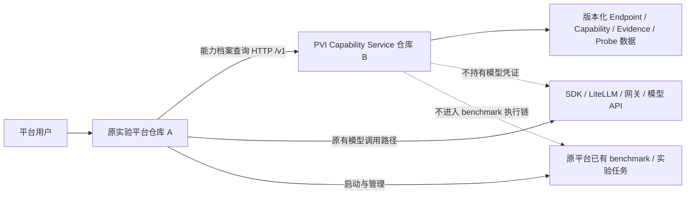
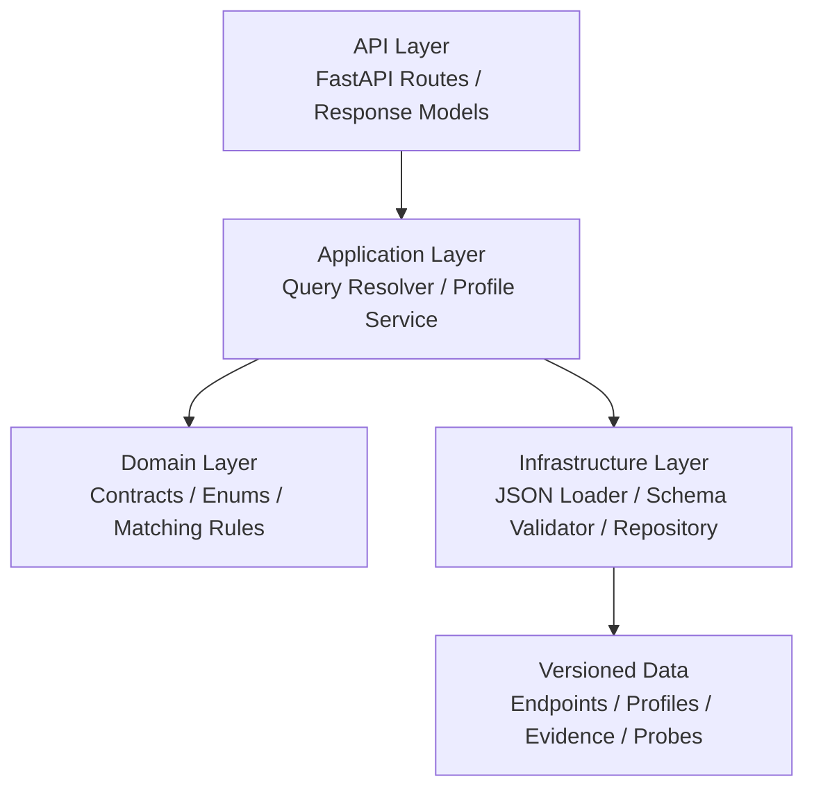
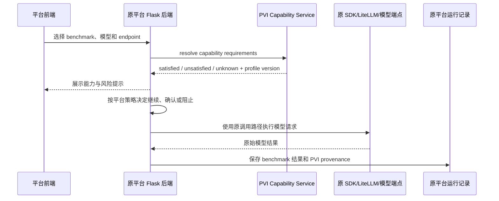
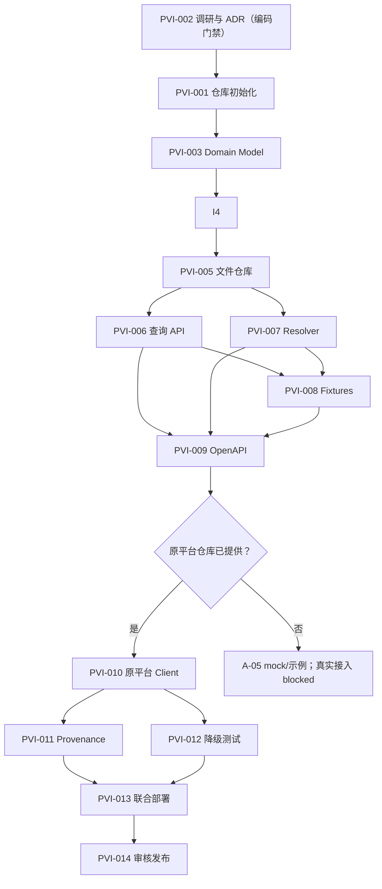

# PVI Capability Service 独立建设与原平台接入实施方案

> **历史计划，非当前权威。** 它记录初期验收 A 的仓库建设与任务拆分，已由根目录
> [`ROADMAP.md`](../../../ROADMAP.md) 和 [`PROJECT_STRUCTURE.md`](../../../PROJECT_STRUCTURE.md) 取代为当前入口。

> **仓库合并决策（2026-07-24）**：后续唯一主仓库为
> `wwweibing-prog/PVIaN-platform`。Capability Service 位于 `src/pvi`，
> Yunwu 4×3 Matrix Probe 位于 `src/pvian_probe`。本文中关于
> `pvi-capability-service` 独立交付仓库的描述保留为原始执行背景，
> 仓库边界以 `decisions/ADR-UNIFIED-REPOSITORY-002.md` 为准。

> **文档用途**：作为独立 GitHub 仓库中建设 PVI 服务、完成离线验收、并接入现有实验平台的实施基线；可直接交给 Codex、Claude Code、Cursor Agent 或其他编码 Agent 执行。
> **依据文件**：`PVI-00：供应商能力、信任、调用与规范化平台正式交接文档` v1.2，2026-07-19。
> **方案版本**：1.1（执行校正版）
> **编制日期**：2026-07-24
> **本期实施范围**：完整实现 **验收 A：能力档案面**；为验收 B 保留清晰扩展边界，但本期不实现 Turn/SSE Runtime。
> **完成后的正确表述**：`PVI Capability Service（验收 A）已完成`，不得表述为“完整 PVI 总成品已完成”。
> **执行前提**：PVI 仓库可独立完成 A-01～A-04 及 A-05 的 mock/示例验收；只有在另行提供原实验平台仓库后，才可实施并声明真实平台侧 PVI-010～PVI-013 已完成。

> **P0 优先级覆盖（2026-07-31）**：本文第 1～44 节仍是验收 A 的实施与历史验收基线，
> 不得据此把验收 A 写成完整 PVI 已完成。新增的透明聚合网关是一个独立工作流，
> 由 [`ADR-TRANSPARENT-GATEWAY-003`](../../../decisions/ADR-TRANSPARENT-GATEWAY-003.md) 和
> [`历史迁移登记`](../transition/gateway-priority-and-migration-register.md)
> 约束；它不等同于验收 B Runtime，也不允许自动路由或 fallback。
> 当前网关 v0.5.0 已有 profile、资格验证、Gateway client Bearer、`/v1/models` public alias 与
> 受鉴权的显式 route 诊断路径；下游业务仓库接入仍须在各自仓库实施。现状与消费者合同见
> [`docs/gateway-consumer-handoff.md`](../../gateway-consumer-handoff.md)。

---

## 0. 如何使用本方案

本方案有三种使用方式：

1. **作为项目实施规格**：放入新建的 PVI GitHub 仓库根目录，建议文件名为 `IMPLEMENTATION_PLAN.md`。
2. **作为编码 Agent 的上下文**：让 Agent 先完整阅读本方案和原始 PVI-00 交接文档，再按第 31～32 章的任务顺序实施。
3. **作为验收清单**：项目负责人依据第 25～30 章检查交付物、离线测试、平台接入和完成定义。

若本方案与原始 PVI-00 交接文档冲突，以原始交接文档中的冻结合同为准。本方案对框架、目录、部署和工程实践所作的选择属于实施建议，不修改原合同。

### 0.1 执行门禁

- 编码前必须先完成 `research/reuse-landscape.md` 和 `decisions/ADR-REUSE-001.md`；ADR 未完成不得以框架默认选择替代复用决策。
- 未提供原实验平台仓库时，不猜测其语言、框架、数据库、benchmark adapter 或运行记录结构；PVI 仓库只交付 HTTP 消费示例、mock contract test 和故障降级样例。
- 未配置 Git 远程或未明确目标 GitHub 仓库时，可以完成本地 Git 初始化、测试和提交，但不得声称已上传。
- OpenAPI 合同固化并通过兼容性检查后，才能据此开发真实平台客户端。
- 两轮审核必须留下可复核记录；“由独立人员/Agent 审核”不能用同一实施者自我声明替代。

---

# 第一部分：项目定位与范围

## 1. 项目目标

在一个新的、独立的 GitHub 仓库中建设轻量级 `PVI Capability Service`，为已经建设好的大模型安全实验平台提供：

- 供应商、网关、本地运行时等实际模型端点的版本化登记；
- 模型/API 能力、端点能力和信任保障维度的结构化描述；
- 官方声明、受控观察、最终有效结论的分离记录；
- 能力需求查询，明确返回满足、不满足和未知项；
- Probe 定义、Probe Run 与 EvidenceReference 的只读查询；
- 实验运行所需的 `endpoint_id + profile_id + profile_version` provenance；
- 无网络、无凭证、无真实供应商调用条件下的离线验收。

该服务完成后，原实验平台仍通过原有 SDK、LiteLLM、网关或 benchmark adapter 调用模型。PVI Capability Service 不进入模型调用链，只负责查询、说明和记录能力边界。

## 2. 本期范围：完整实现验收 A

本期必须完成：

```text
A-01  Endpoint / Capability Profile JSON Schema
A-02  静态档案加载与只读查询 API
A-03  capability-queries:resolve 的满足/不满足/未知匹配
A-04  官方声明、观察证据与 Probe Catalog fixtures
A-05  原实验平台原调用路径接入示例与独立验收
```

本期仓库可以保留 `runtime/` 或 `contracts/canonical/` 的扩展说明，但不得实现一个未经本期验收要求驱动的半成品 Runtime。

## 3. 明确不属于本期的内容

以下内容不得因为“以后可能需要”而加入本期：

- PVI Turn/SSE Runtime；
- 供应商 runtime adapter；
- Canonical Stream Event 生成；
- PVI–HFI 工具执行闭环；
- 自动模型路由、自动端点选择、自动 failover；
- 消息队列、outbox、长周期事件仓库；
- 在线 Probe 调度器；
- 价格排序和成本优化；
- 人工审批流、数据等级策略引擎、自动工具授权；
- MCP Server、MCP 商城；
- Skill 创建、分发、审核或执行；
- 业务工具执行；
- 管理后台或复杂前端；
- 真实供应商 API Key 和真实线上请求；
- 将 PVI 代码复制进原平台；
- 让两个仓库共享数据库或内部 Python 类。

## 4. PVI Capability Service 负责什么

### 4.1 必须负责

- 端点档案的加载、Schema 校验、版本管理和只读查询；
- Capability Profile 的加载、Schema 校验和只读查询；
- 信任保障维度的结构化记录；
- 能力结论的 `advertised / observed / effective` 分离；
- EvidenceReference 的引用和查询；
- Probe Catalog 与已有 Probe Run 的只读查询；
- 能力要求解析；
- 返回候选 profile、满足项、不满足项、未知项及证据引用；
- 提供 OpenAPI v1；
- 提供离线 fixtures 和单一验收入口；
- 保证未知项保持未知，不通过猜测提升为支持；
- 为原平台提供稳定的 HTTP 合同。

### 4.2 不负责

- 替平台选择最终要用的端点；
- 代表平台调用模型；
- 管理模型供应商 API Key；
- 决定是否允许某个 benchmark 运行；
- 自动执行工具；
- 评价模型的通用智能水平；
- 判断 benchmark 结果是否正确；
- 统一各 benchmark 内部 runner、scorer 或 oracle；
- 管理实验平台的任务队列、容器、Kubernetes Job 或结果数据库。

PVI 只返回事实、证据和未知项。是否警告、阻止或继续运行，由原平台自己的策略决定。

---

# 第二部分：总体架构

## 5. 两个 GitHub 仓库的关系



### 5.1 仓库 A：原实验平台

原平台继续负责：

- 前端页面；
- 原平台已有后端；
- benchmark 调度；
- benchmark adapter；
- 模型调用；
- API Key 与模型配置；
- 运行状态、日志、trajectory 和结果；
- 用户权限和平台策略；
- 将 PVI 结果写入运行 provenance。

原平台只新增一个薄的 PVI HTTP Client 和少量接入逻辑，不导入 PVI 内部代码。

### 5.2 仓库 B：PVI Capability Service

独立负责：

- PVI 合同；
- 端点和能力档案；
- Evidence 和 Probe 数据；
- Capability Query；
- OpenAPI；
- 离线 fixtures；
- CI 和验收脚本；
- 接入说明。

### 5.3 可选仓库 C：部署编排仓库

若希望两个业务仓库完全独立，可另建部署仓库：

```text
platform-deployment/
├── docker-compose.yml
├── .env.example
├── reverse-proxy/
└── docs/
```

仓库 C 只负责编排，不复制仓库 A 或 B 的业务源代码。

## 6. PVI 仓库内部架构

本方案推荐使用 **Python + FastAPI + Pydantic + 版本化 JSON/YAML 文件**。

选择理由：

- PVI 合同要求 JSON Schema 和 OpenAPI；
- FastAPI 可以直接以类型模型生成并校验 OpenAPI；
- Pydantic 适合将 Schema 约束映射为运行时模型；
- 验收 A 是只读服务，不需要数据库；
- 档案通过 Git PR 审核，版本和历史清晰；
- 原平台使用 Flask 不影响独立服务使用 FastAPI，两者仅通过 HTTP 交互。

该框架选择属于实施建议，不是 PVI 冻结合同的一部分。

### 6.1 分层结构



职责要求：

- `domain` 不依赖 FastAPI、文件系统或原平台；
- `application` 编排查询和匹配规则；
- `infrastructure` 负责从版本化文件加载数据；
- `api` 只负责 HTTP 输入输出和错误映射；
- 原平台客户端不得调用 `domain` 或 `infrastructure`，只能调用 HTTP API。

## 7. 推荐仓库目录

```text
pvi-capability-service/
├── README.md
├── IMPLEMENTATION_PLAN.md
├── pyproject.toml
├── uv.lock / requirements.lock
├── .env.example
├── .gitignore
├── Dockerfile
├── docker-compose.yml
│
├── src/
│   └── pvi/
│       ├── __init__.py
│       ├── main.py
│       ├── config.py
│       │
│       ├── api/
│       │   ├── dependencies.py
│       │   ├── errors.py
│       │   └── routes/
│       │       ├── endpoints.py
│       │       ├── capability_profiles.py
│       │       ├── capability_queries.py
│       │       ├── probes.py
│       │       ├── probe_runs.py
│       │       ├── evidence.py
│       │       └── health.py
│       │
│       ├── domain/
│       │   ├── enums.py
│       │   ├── endpoint_profile.py
│       │   ├── capability_profile.py
│       │   ├── evidence.py
│       │   ├── probes.py
│       │   ├── requirements.py
│       │   └── errors.py
│       │
│       ├── application/
│       │   ├── endpoint_service.py
│       │   ├── profile_service.py
│       │   ├── capability_resolver.py
│       │   └── provenance.py
│       │
│       └── infrastructure/
│           ├── file_repository.py
│           ├── schema_validator.py
│           ├── data_loader.py
│           └── checksum.py
│
├── contracts/
│   ├── schemas/
│   │   ├── endpoint-profile.schema.json
│   │   ├── capability-profile.schema.json
│   │   ├── evidence-reference.schema.json
│   │   ├── probe-catalog.schema.json
│   │   ├── probe-run.schema.json
│   │   └── capability-resolution.schema.json
│   └── openapi/
│       └── capability-v1.openapi.yaml
│
├── data/
│   ├── endpoints/
│   ├── capability-profiles/
│   ├── evidence/
│   ├── probe-runs/
│   └── catalog/
│       └── probe-catalog.yaml
│
├── fixtures/
│   └── capability/
│       ├── official-native-tool-supported/
│       ├── broker-openai-compatible-unknown-streaming/
│       ├── same-model-different-endpoints/
│       ├── advertised-not-observed/
│       ├── simple-model-endpoint-query/
│       └── requirements-resolution/
│
├── mappings/
│   └── capability-source-template.md
│
├── examples/
│   ├── platform-direct-path.md
│   ├── platform-pvi-client.py
│   └── run-provenance.json
│
├── research/
│   └── reuse-landscape.md
│
├── decisions/
│   └── ADR-REUSE-001.md
│
├── acceptance/
│   ├── run-offline.ps1
│   ├── run-offline.sh
│   └── forbidden-patterns.txt
│
├── scripts/
│   ├── export_openapi.py
│   ├── validate_data.py
│   ├── validate_openapi.py
│   └── check_forbidden_fields.py
│
├── tests/
│   ├── unit/
│   ├── contract/
│   ├── integration/
│   └── acceptance/
│
└── .github/
    └── workflows/
        ├── ci.yml
        └── release.yml
```

---

# 第三部分：核心数据合同

## 8. 端点身份与分类

能力结论必须绑定到具体端点，而不是只绑定模型名称。

每个 Endpoint Profile 至少记录：

```text
endpoint_id
endpoint_kind
provider_id
api_surface
api_version
model_requested
model_reported
model_revision
deployment_id
region
relevant_configuration_digest
observed_at
profile_version
```

`endpoint_kind` 首版使用：

```text
official_direct
managed_cloud
broker_gateway
self_hosted_gateway
local_open_weights
local_opaque_runtime
unknown
```

约束：

- 不得把平台名称直接硬编码为高可信或低可信；
- 同一模型通过不同 Endpoint 暴露时，必须形成不同档案；
- `model_requested` 与 `model_reported` 必须分开；
- 不能因为模型 alias 相似就推断真实上游；
- 中转端点需要额外记录声明上游、报告模型、路由观察和转换保真信息；
- “OpenAI-compatible”不能自动等同于协议完全保真。

## 9. 信任保障维度

首版必须记录三个核心维度：

```text
identity_assurance
model_provenance_assurance
protocol_fidelity_assurance
```

可选维度：

```text
data_handling_assurance
operational_assurance
```

状态枚举：

```text
verified
governed
declared_unverified
unknown
failed
```

协议保真枚举：

```text
native
documented_translation
observed_translation
lossy_translation
unknown
```

硬性规则：

- 不得将多个维度合成一个“可信总分”；
- 运营主体可核验，不代表协议转换无损；
- 数据不出机，不代表模型权重来源可信；
- PVI 只记录事实和未知项，不作平台审批决定。

## 10. Capability Profile

能力状态固定为：

```text
supported
unsupported
unknown
not_tested
not_applicable
inconclusive
```

每项能力必须保留：

```text
advertised  # 官方、网关或目录声明
observed    # 受控 Probe 结果
effective   # 对消费者实际可用的结论
```

最低能力领域包括：

- 消息角色与富内容；
- 多模态输入输出；
- Structured Output；
- 工具调用表示；
- 工具参数流；
- 多工具和并行工具；
- call/result 关联；
- reasoning 暴露和续接；
- usage 与上下文限制；
- 流式、取消与恢复；
- sampling 控制；
- logprobs、full logits、权重和 tokenizer；
- 供应商/网关内建工具；
- 网关重试、路由和模型披露。

工具调用表示至少支持：

```text
native_structured
native_structured_streaming
json_text_simulation
xml_text_simulation
markdown_text_simulation
provider_builtin
gateway_builtin
unsupported
unknown
```

文本模拟不得被标记为原生结构化工具调用。

Reasoning 暴露至少支持：

```text
none
token_usage_only
summary_only
visible_reasoning_text
opaque_continuation_artifact
mixed
unknown
```

PVI 记录供应商实际暴露形式，不以获取或保存完整内部 chain-of-thought 为目标。

## 11. Evidence 与 Probe

### 11.1 Probe 的边界

Probe 只验证接口能力和行为，不评价模型的通用智力或 benchmark 得分。本期只提供 Probe Catalog、脱敏 fixtures 和已有 Probe Run 的只读查询，不发送真实请求。

### 11.2 Probe Catalog 最低项

```text
text_message_probe
role_support_probe
multimodal_content_probe
structured_output_probe
native_tool_call_probe
text_simulated_tool_probe
multiple_tool_call_probe
streaming_arguments_probe
invalid_json_probe
stream_interruption_probe
tool_result_correlation_probe
reasoning_exposure_probe
continuation_artifact_probe
usage_probe
seed_repeatability_probe
logprobs_probe
full_logits_probe
unknown_event_probe
gateway_fidelity_probe
```

### 11.3 结论更新规则

- 官方声明只能更新 `advertised`；
- 受控、有效、证据完整的 Probe 才能更新 `observed`；
- 单次随机失败不能直接证明 `unsupported`；
- API、模型、网关路由、运行时或关键配置变化后，旧结论必须失效或重新验证；
- 网关观察不能替代官方原生端点结论；
- `unknown`、`not_tested`、`inconclusive` 不得转写为支持。

### 11.4 EvidenceReference

至少包含：

```text
evidence_id
source_kind
host_profile_id
capture_surface
sha256
media_type
redaction_profile
locator
captured_at
retention_class
```

本期只要求证据能够被引用，不建设完整证据仓库。可以保存摘要、digest 或外部定位信息。不得将凭证、敏感 Header 或未经授权的隐藏推理写入 evidence、fixture 或普通日志。

---

# 第四部分：对外 API

## 12. 冻结的验收 A API

基础路径：`/v1`

| 方法 | 路径 | 目的 |
|---|---|---|
| GET | `/v1/endpoints` | 查询已登记端点 |
| GET | `/v1/endpoints/{endpoint_id}` | 读取端点及保障维度 |
| GET | `/v1/capability-profiles` | 查询能力档案 |
| GET | `/v1/capability-profiles/{profile_id}` | 读取完整能力档案 |
| POST | `/v1/capability-queries:resolve` | 按模型、端点和能力条件解析候选 |
| GET | `/v1/probes` | 查询 Probe Catalog |
| GET | `/v1/probe-runs/{run_id}` | 查询已有 Probe 结果 |
| GET | `/v1/evidence/{evidence_id}` | 查询证据引用 |

实现可以额外提供：

```text
GET /healthz
GET /readyz
```

这两个属于运维端点，不得混入 PVI frozen contract，也不得改变 `/v1` 返回结构。

## 13. 通用 API 规则

- JSON 使用 UTF-8；
- API 路径使用 `/v1`；
- 所有 ID 为不透明字符串；
- 时间使用 RFC 3339 UTC；
- 凭证不得进入请求体、响应体、档案和日志；
- 列表接口应支持稳定分页；
- 相同输入和相同数据版本必须得到确定性结果；
- 错误响应必须结构化，不能只返回框架默认 HTML；
- PVI 不自动调用候选端点；
- PVI 不返回“已替用户选择的唯一模型”，应返回候选和理由。

推荐错误结构：

```json
{
  "error": {
    "code": "profile_not_found",
    "message": "Capability profile was not found.",
    "details": {},
    "request_id": "opaque-request-id"
  }
}
```

## 14. Capability Query 设计

### 14.1 简单查询

原平台可以只提交：

```json
{
  "model": "requested-model-name",
  "endpoint_id": "endpoint-opaque-id"
}
```

服务返回完整匹配档案或明确的无匹配结果。

### 14.2 Requirements 查询

```json
{
  "model": "requested-model-name",
  "endpoint_id": "endpoint-opaque-id",
  "requirements": {
    "tool_calling.representation": "native_structured",
    "tool_calling.multiple_calls_per_turn": "supported",
    "reasoning.exposure": ["summary_only", "visible_reasoning_text"]
  }
}
```

推荐响应：

```json
{
  "schema_version": "pvi.capability-resolution/v1",
  "query_id": "query-opaque-id",
  "resolved_at": "2026-07-24T00:00:00Z",
  "candidates": [
    {
      "profile_id": "cap-profile-opaque-id",
      "profile_version": "1.0.0",
      "endpoint_id": "endpoint-opaque-id",
      "satisfied": [
        {
          "requirement": "tool_calling.representation",
          "actual": "native_structured",
          "evidence_ids": ["evidence-001"]
        }
      ],
      "unsatisfied": [],
      "unknown": [
        {
          "requirement": "reasoning.exposure",
          "actual": "unknown",
          "reason": "not_tested",
          "evidence_ids": []
        }
      ]
    }
  ]
}
```

### 14.3 匹配算法

Agent 必须实现并单元测试以下规则：

1. 先按明确的 `endpoint_id`、模型身份字段和版本字段筛选候选；不得使用模糊字符串猜测真实模型。
2. 对状态型要求，优先读取 `effective`。
3. `supported` 或精确枚举匹配进入 `satisfied`。
4. `unsupported` 或明确枚举冲突进入 `unsatisfied`。
5. `unknown`、`not_tested`、`inconclusive`、字段缺失进入 `unknown`。
6. `not_applicable` 只有在该要求确实不适用于目标能力时才可作为明确结果，不得当作支持。
7. Evidence ID 必须沿结论返回；无证据时保留空数组，不能伪造。
8. 返回多个候选时使用确定性排序，例如 `endpoint_id + profile_id + profile_version`，不得按主观“可信度总分”排序。
9. Resolver 只解析，不调用模型、不改写档案、不自动选择端点。

---

# 第五部分：与原实验平台的接入

## 15. 接入原则

原平台是验收 A 的消费者，保持原有模型调用路径：



硬性边界：

- 原平台不通过 PVI 调用模型；
- PVI 不读取原平台数据库；
- 原平台不读取 PVI 的 `data/` 目录；
- 两边不共享 ORM Model；
- 两边不互相导入源码；
- 不使用 Git Submodule 形成运行依赖；
- API Key 只留在原平台或原有模型网关；
- PVI 暂时不可用时，原平台原有模型调用链仍应可运行。

## 16. 原平台新增的最小组件

本章描述的是待接入合同，不代表已确认原平台技术栈。实施前必须读取用户另行提供的原平台仓库；未提供时只实现 `examples/` 中的独立 HTTP 客户端和 mock，不得创建虚构的数据库迁移或平台内部模块。

建议在原平台仓库增加：

```text
backend/
└── integrations/
    └── pvi/
        ├── client.py
        ├── models.py
        ├── service.py
        ├── errors.py
        └── tests/
```

### 16.1 PVI Client 的最小接口

```python
from typing import Protocol


class PVIClientProtocol(Protocol):
    def get_profile(self, profile_id: str) -> dict: ...

    def resolve_capabilities(
        self,
        *,
        model: str,
        endpoint_id: str,
        requirements: dict | None = None,
    ) -> dict: ...
```

要求：

- 设置短超时；
- 对连接失败、超时、404、Schema 不兼容分别处理；
- 不无限重试；
- 不在日志中打印认证 Header；
- 支持注入 mock client 完成平台侧测试；
- 不将 PVI 响应直接当作模型调用参数。

### 16.2 原平台环境变量

```env
PVI_ENABLED=true
PVI_BASE_URL=http://pvi-capability:5100
PVI_TIMEOUT_SECONDS=3
PVI_FAILURE_MODE=warn
PVI_EXPECTED_API_VERSION=v1
```

`PVI_FAILURE_MODE` 是原平台自己的策略，不属于 PVI 冻结合同。建议首期支持：

```text
warn       # PVI 不可用或 unknown 时提示，但不破坏原调用链
strict     # 对特定 benchmark 可要求能力档案可用
disabled   # 完全关闭 PVI 接入
```

默认推荐 `warn`。明确 `unsupported` 时是否阻止运行，由原平台根据 benchmark 要求决定，PVI 不作最终决策。

## 17. Benchmark 能力要求配置

原平台可为每个 benchmark 或 harness 定义能力要求，例如：

```yaml
benchmark_requirements:
  cybench:
    text_generation.effective: supported
  cybergym:
    text_generation.effective: supported
    tool_calling.effective: supported
  cve_bench:
    text_generation.effective: supported
  exploitbench:
    text_generation.effective: supported
```

注意：以上仅为配置结构示例。Agent 不得凭名称臆测各 benchmark 的真实能力要求；应依据原平台实际 harness 和模型调用代码填写。未核实的要求必须标记为 TBD 或不配置。

## 18. Run Provenance

每次实验运行至少记录：

```json
{
  "pvi": {
    "invocation_mode": "consumer_direct",
    "endpoint_id": "endpoint-opaque-id",
    "capability_profile_id": "cap-profile-opaque-id",
    "capability_profile_version": "1.0.0",
    "capability_schema_version": "pvi.capability-profile/v1",
    "resolution_query_id": "query-opaque-id",
    "resolved_at": "2026-07-24T00:00:00Z",
    "satisfied_requirements": [],
    "unsatisfied_requirements": [],
    "unknown_requirements": [],
    "pvi_service_version": "1.0.0"
  }
}
```

原平台不需要复制：

- 全部 Capability Profile；
- 全部 Evidence 内容；
- Probe 配置；
- PVI 内部文件路径；
- 供应商凭证。

为了保证历史实验可解释性，可以保存本次 Resolution 的必要摘要；不得将其误标记为 PVI 全链路观察，因为模型请求仍由原平台直接发出。

## 19. PVI 故障时的行为

必须测试：

| 场景 | 原平台行为 |
|---|---|
| PVI 正常且满足要求 | 正常运行并保存 provenance |
| PVI 返回 unknown | 显示未知项，按平台策略继续或确认 |
| PVI 返回 unsupported | 显示明确不满足；由平台策略决定阻止或确认 |
| PVI 超时 | 标记 capability check unavailable；原调用路径不崩溃 |
| PVI 连接失败 | 同上，不得影响 benchmark adapter 本身 |
| PVI 返回不兼容 Schema | 明确报兼容性错误，不得静默接受 |
| Profile 在运行前后变化 | 本次运行保存实际查询到的 profile version |

---

# 第六部分：部署与 GitHub 协作

## 20. 本地和服务器部署

推荐使用 Docker Compose，将两个服务放在同一内部网络：

```yaml
services:
  platform:
    build: ./platform
    environment:
      PVI_ENABLED: "true"
      PVI_BASE_URL: "http://pvi-capability:5100"
      PVI_TIMEOUT_SECONDS: "3"
      PVI_FAILURE_MODE: "warn"
    depends_on:
      pvi-capability:
        condition: service_healthy

  pvi-capability:
    build: ./pvi-capability-service
    expose:
      - "5100"
    healthcheck:
      test: ["CMD", "python", "-c", "import urllib.request; urllib.request.urlopen('http://localhost:5100/healthz')"]
      interval: 10s
      timeout: 3s
      retries: 5
```

说明：

- `depends_on` 只帮助启动编排，不得让原平台模型调用逻辑硬依赖 PVI；
- PVI 默认只暴露在 Docker 内部网络；
- 若需要公网访问，应通过反向代理、TLS 和服务鉴权，不直接暴露开发服务器；
- 本期 PVI 不需要 PostgreSQL、Redis、消息队列或 Kubernetes；
- 后续若原平台整体部署到 Kubernetes，可将 PVI 作为独立 Deployment 和 ClusterIP Service，不改变 HTTP 合同。

## 21. GitHub 分支和发布策略

推荐：

```text
main          受保护、可发布
feature/*     功能开发
fix/*         缺陷修复
contract/*    Schema/OpenAPI 合同修改
```

每个 Pull Request 必须包含：

- 变更原因；
- 是否影响 frozen contract；
- 是否需要 ADR；
- 新增或修改的测试；
- 离线验收结果；
- 是否改变原平台接入行为；
- 是否包含 TBD 或供应商专有结论。

版本建议：

- API 路径版本：`/v1`；
- Schema 版本：`pvi.capability-profile/v1` 等；
- 服务发布版本：语义化版本，如 `1.0.0`；
- 档案版本：每份 profile 独立版本；
- Git commit 不能替代对外合同版本。

## 22. CI

PVI 仓库 GitHub Actions 至少执行：

```text
1. Python 静态检查和格式检查
2. 单元测试
3. JSON Schema Draft 2020-12 校验
4. OpenAPI 校验
5. 所有 data/ 与 fixtures/ 校验
6. capability resolver contract tests
7. 禁止字段和敏感信息扫描
8. TBD 合法性扫描
9. 无网络离线验收
10. Docker image build
```

原平台仓库 CI 使用 mock PVI 测试：

```text
1. 正常查询
2. unknown
3. unsupported
4. 404
5. 超时
6. 连接失败
7. Schema 不兼容
8. provenance 写入
9. PVI 故障时原模型调用路径仍可用
```

两个仓库的普通 CI 不应强制拉起对方的真实服务。

---

# 第七部分：安全、日志与配置

## 23. 安全要求

所有部署必须满足：

- 模型凭证只通过原平台或部署环境的 Secret Reference 注入；
- PVI Capability Service 本期不持有模型 API Key；
- 档案、日志、fixtures、错误响应不得包含凭证；
- Prompt、工具结果、MCP 描述和 Skill 描述均视为不可信输入；
- 不记录未经授权的完整隐藏推理；
- 失败不得记录为成功；
- 未知字段必须保持 `unknown` 或 `unavailable`；
- Evidence locator 不得暴露本机敏感绝对路径或私有 Token；
- 日志只记录不透明 ID、状态、耗时和安全摘要；
- 对外错误信息不得包含堆栈、文件内容或环境变量。

## 24. 配置要求

PVI 服务推荐配置：

```env
PVI_HOST=0.0.0.0
PVI_PORT=5100
PVI_DATA_DIR=/app/data
PVI_CONTRACT_DIR=/app/contracts
PVI_LOG_LEVEL=INFO
PVI_ENVIRONMENT=development
PVI_REQUIRE_DATA_VALIDATION=true
PVI_FAIL_STARTUP_ON_INVALID_DATA=true
```

要求：

- 启动时校验所有档案；
- 任一冻结结构数据无效时，服务不得“带病启动”；
- 不得自动下载依赖或在线补全资料；
- 供应商尚未确定的专有字段使用 `TBD — target not selected` 或合同允许的 unknown，不得猜测。

---

# 第八部分：验收方案

## 25. 公共交付物

```text
docs/architecture.md
docs/consumer-integration.md
research/reuse-landscape.md
decisions/ADR-REUSE-001.md
contracts/schemas/endpoint-profile.schema.json
contracts/schemas/evidence-reference.schema.json
acceptance/run-offline.ps1
```

## 26. 验收 A 必须交付

```text
contracts/schemas/capability-profile.schema.json
contracts/openapi/capability-v1.openapi.yaml
data/catalog/probe-catalog.yaml
fixtures/capability/
mappings/capability-source-template.md
examples/platform-direct-path.md
```

另外，本实施方案要求提供：

```text
README.md
Dockerfile
.env.example
acceptance/run-offline.sh
examples/platform-pvi-client.py
examples/run-provenance.json
```

## 27. 最低 Fixtures

### Fixture A1：官方端点

- 原生结构化工具调用为 `supported`；
- 带官方声明或观察 EvidenceReference；
- `advertised` 与 `observed` 状态清晰。

### Fixture A2：OpenAI-compatible 中转端点

- 外形兼容；
- 工具流式语义为 `unknown` 或 `lossy`；
- 不能自动标记为 exact/native。

### Fixture A3：同一模型、两个端点

- 同一模型经两个 Endpoint 暴露不同能力；
- 查询结果不得合并为模型级布尔值。

### Fixture A4：只有声明、没有实测

- `advertised=supported`；
- `observed=not_tested`；
- 不得自动把 `effective` 提升为实测支持。

### Fixture A5：简单查询

- 只提供 `model + endpoint_id`；
- 不提供复杂 requirements；
- 可以返回完整档案。

### Fixture A6：Requirements 查询

- 同一次查询中包含满足、不满足和未知；
- Resolution 正确分类并返回 Evidence ID。

## 28. 单一离线验收入口

Windows：

```powershell
./acceptance/run-offline.ps1
```

Linux/macOS：

```bash
./acceptance/run-offline.sh
```

必须在无网络、无模型凭证环境中完成：

- JSON Schema 校验；
- OpenAPI 校验；
- 所有档案和 fixtures 校验；
- A1～A6 行为测试；
- `advertised / observed / effective` 分离测试；
- `unknown` 不升级测试；
- 同模型多端点不合并测试；
- 禁止字段扫描；
- 凭证和敏感 Header 扫描；
- 未授权外部网络调用扫描；
- 原平台 mock client contract test；
- PVI 服务关闭时原平台 mock 模型调用仍通过。

验收脚本不得在运行时自动下载依赖。

## 29. 两轮审核

### 第一轮：技术审核

检查：

- Schema、Pydantic 模型、OpenAPI、示例和 fixtures 一致；
- 模型能力、端点能力和运行器能力没有混淆；
- 平台名称没有被硬编码为高可信或低可信；
- 未知项没有被转为支持；
- 安全和日志规则可执行；
- 没有编造供应商专有语义；
- 原平台模型调用路径没有被 PVI 替换。

### 第二轮：独立接手审核

由未参与设计的人或独立 Agent 执行：

- 只阅读仓库文档即可解释架构；
- 可以启动服务；
- 可以运行离线验收；
- 可以定位一个故意注入的无效 profile；
- 可以说明 A 与 B 的边界；
- 不需要访问未公开的原平台内部背景；
- 不需要真实供应商凭证。

## 30. 本期完成定义

只有同时满足以下条件，才能声明“PVI Capability Service 验收 A 完成”：

- A-01～A-05 全部完成；
- 冻结 API 全部可用；
- 交付物齐全；
- A1～A6 fixtures 全部通过；
- 离线验收入口通过；
- 两轮审核完成；
- 原平台能通过 `profile_id` 或 Capability Query 获得能力边界；
- 原平台能保存 `profile_id + profile_version`；
- 原平台仍走原模型调用路径；
- PVI 服务关闭后，原平台原有模型调用测试仍通过；
- 未声称真实供应商已完成受控接入；
- 未声称验收 B 或 PVI 总成品已经完成。

若原实验平台仓库尚未提供，允许且只能声明：

> `PVI Capability Service A-01～A-04 与 A-05 mock/接入示例已完成；真实原平台接入、平台 provenance 和联合部署待原平台仓库提供后验收。`

---

# 第九部分：任务拆分与实施顺序

## 31. GitHub Issue 建议

### PVI-001：仓库初始化

交付：目录、`pyproject.toml`、FastAPI 骨架、Dockerfile、CI 基础。

### PVI-002：复用调研与 ADR

交付：

```text
research/reuse-landscape.md
decisions/ADR-REUSE-001.md
```

必须说明是否复用现有 JSON Schema/OpenAPI 工具，不能只按 Star 数选择。

### PVI-003：核心枚举与 Domain Model

交付：端点类型、保障状态、协议保真、能力状态、Evidence、Probe 类型模型。

### PVI-004：JSON Schema Draft 2020-12

交付：Endpoint、Capability Profile、Evidence、Probe、Resolution Schema。

### PVI-005：版本化文件仓库

交付：安全文件加载、启动校验、稳定索引、重复 ID/版本检测。

### PVI-006：只读查询 API

交付：Endpoints、Profiles、Probes、Probe Runs、Evidence 路由。

### PVI-007：Capability Resolver

交付：简单查询、Requirements 查询、满足/不满足/未知算法和单元测试。

### PVI-008：Fixtures 与离线验收

交付：A1～A6、PowerShell/Bash 单一入口、禁止字段扫描。

### PVI-009：OpenAPI 固化

交付：导出并校验 `capability-v1.openapi.yaml`，防止实现与合同漂移。

### PVI-010：原平台 PVI Client

前置条件：用户已提供原平台仓库及其接入范围。在原平台仓库开发；交付薄客户端、mock、错误分类和环境变量。若前置条件不满足，本 Issue 保持 blocked，不得在 PVI 仓库中伪造平台实现。

### PVI-011：原平台 provenance

前置条件：PVI-010 完成且原平台运行记录结构已确认。交付运行记录字段、序列化、必要迁移（仅当原平台实际使用数据库）和结果展示。

### PVI-012：平台故障降级测试

交付正常、unknown、unsupported、超时、断连、Schema 不兼容测试。

### PVI-013：Docker Compose 联合部署

前置条件：原平台仓库与部署方式已确认。交付内部网络、健康检查和 `.env.example`。PVI 仓库自身的单服务 Docker Compose 不受此门禁影响。

### PVI-014：两轮审核与发布

交付审核记录、验收结果、`v1.0.0` Release Notes。

## 32. 依赖关系



---

# 第十部分：Agent 执行规则

## 33. Agent 必须遵守的规则

1. 先阅读原始 PVI-00 交接文档和本实施方案，再改代码。
2. 任何“必须/不得”都作为硬约束。
3. 本期只实现验收 A；不得擅自加入验收 B Runtime。
4. 不得把 PVI 扩展成通用 LLM Gateway。
5. 不得改变原平台模型调用路径。
6. 不得共享数据库、内部模型类或文件目录。
7. 不得根据名称猜测供应商、上游模型或可信度。
8. 不得把 `unknown/not_tested/inconclusive` 转换成支持。
9. 不得把文本模拟工具调用标记为原生结构化调用。
10. 不得生成虚假 Evidence。
11. 不得发送真实模型请求或使用真实凭证。
12. 不得为了通过测试而模拟供应商不存在的能力。
13. 每完成一个 Issue，必须运行相关测试并记录结果。
14. 修改合同前先说明是否属于兼容变更；不兼容变更必须停止并提交 ADR 草案。
15. 不得在没有测试结果的情况下声称任务完成。

## 34. Agent 的工作输出格式

每个阶段结束时，Agent 应报告：

```text
完成的 Issue：
修改的文件：
实现的合同：
新增的测试：
执行的命令：
测试结果：
未完成项：
TBD：
风险或偏离：
下一步：
```

Agent 应优先提交小而可审查的 Pull Request，不在一个 PR 中同时重写架构、修改合同并接入原平台。

---

# 第十一部分：可直接交给编码 Agent 的总提示词

## 35. Master Prompt

将以下内容与本文件、原始 PVI-00 交接文档一起交给编码 Agent。替换尖括号中的占位符。

```text
你是一名负责 Python 后端、API 合同、JSON Schema、测试和 GitHub 工程化的高级开发 Agent。

你的任务是在独立 GitHub 仓库 <PVI_REPOSITORY_URL_OR_PATH> 中建设 PVI Capability Service，并在后续阶段通过 HTTP API 接入已有实验平台仓库 <PLATFORM_REPOSITORY_URL_OR_PATH>。

你必须先完整阅读：
1. PVI-00：供应商能力、信任、调用与规范化平台正式交接文档；
2. IMPLEMENTATION_PLAN.md（本方案）；
3. 原平台 README、后端入口、模型配置、benchmark adapter 和运行记录结构。

本期唯一验收范围是“验收 A：能力档案面”：
- A-01 Endpoint / Capability Profile JSON Schema；
- A-02 静态档案加载与只读查询 API；
- A-03 capability-queries:resolve；
- A-04 Evidence、Probe Catalog 和 fixtures；
- A-05 原平台保留原模型调用路径的接入与独立验收。

本期不得实现：
- Turn/SSE Runtime；
- provider runtime adapter；
- Canonical Stream；
- 自动路由或 failover；
- 消息队列；
- 在线 Probe；
- 管理 UI；
- MCP Server、Skill 商城或业务工具执行；
- 真实供应商请求；
- 与原平台共享数据库或导入内部源码。

推荐技术实现：
- Python；
- FastAPI；
- Pydantic；
- JSON Schema Draft 2020-12；
- 版本化 JSON/YAML 数据；
- pytest；
- Docker；
- GitHub Actions。

架构要求：
- domain/application/infrastructure/api 分层；
- PVI 与原平台通过 /v1 HTTP API 交互；
- PVI 不进入模型调用路径；
- PVI 关闭时，原平台原有模型调用测试仍通过；
- 原平台只保存 endpoint_id、profile_id、profile_version 和必要 Resolution 摘要；
- PVI 不持有模型 API Key。

必须实现的接口：
GET /v1/endpoints
GET /v1/endpoints/{endpoint_id}
GET /v1/capability-profiles
GET /v1/capability-profiles/{profile_id}
POST /v1/capability-queries:resolve
GET /v1/probes
GET /v1/probe-runs/{run_id}
GET /v1/evidence/{evidence_id}

必须实现并测试的规则：
- 同一模型不同端点不能合并；
- advertised、observed、effective 分离；
- unknown、not_tested、inconclusive 不得升级；
- OpenAI-compatible 不自动等于协议完全保真；
- 模型 alias、requested model、reported model 分开；
- 信任维度不得合成单一分数；
- Capability Query 返回 satisfied、unsatisfied、unknown 和 evidence IDs；
- Resolver 不调用模型、不自动选择端点；
- 所有数据启动时通过 Schema 校验；
- 不得把凭证写入日志、fixture 或响应。

必须提供 A1～A6 fixtures 和以下离线验收入口：
./acceptance/run-offline.ps1
./acceptance/run-offline.sh

实施顺序严格按照 IMPLEMENTATION_PLAN.md 第 31～32 章。

工作方式：
1. 先检查仓库现状，列出与目标架构的差距；
2. 形成不超过一个阶段的具体执行计划；
3. 实施该阶段；
4. 运行测试；
5. 报告修改文件、测试命令、结果、TBD 和下一步；
6. 在得到下一阶段指令前，不擅自扩展范围。

不要询问已经在文档中给出的信息。遇到供应商、网关、模型或原平台字段无法从仓库确认时，使用清晰的 TBD 或适配接口，不要猜测。

现在从 PVI-001“仓库初始化”开始。先输出仓库审查结果和本阶段文件计划，然后直接实施并运行测试。
```

---

# 第十二部分：分阶段提示词

## 36. 阶段一：合同与仓库骨架

```text
阅读 PVI-00 和 IMPLEMENTATION_PLAN.md。只完成 PVI-001～PVI-004：仓库骨架、ADR、Domain Model 和 JSON Schema。不要实现原平台接入，不要实现 Runtime。完成后运行 Schema 和单元测试，并报告合同字段与原文的对应关系。
```

## 37. 阶段二：只读服务

```text
在现有 PVI 仓库中完成 PVI-005～PVI-007：版本化文件仓库、全部验收 A 查询 API、Capability Resolver。确保所有数据启动时校验，Resolver 返回 satisfied/unsatisfied/unknown，不调用任何外部模型。完成后运行单元和 API contract tests。
```

## 38. 阶段三：Fixtures 与离线验收

```text
完成 PVI-008～PVI-009：A1～A6 fixtures、PowerShell/Bash 离线验收、OpenAPI 固化、禁止字段扫描。验收过程必须无网络、无模型凭证。故意加入一个临时无效 fixture 验证脚本会失败，随后删除该临时 fixture 并确认全部通过。
```

## 39. 阶段四：原平台接入

```text
阅读原平台仓库后端入口、模型配置、benchmark adapter、任务创建流程和运行记录结构。完成 PVI-010～PVI-012：薄 PVI Client、能力检查服务、provenance、mock 和降级测试。不得改变模型实际调用路径，不得导入 PVI 内部代码，不得共享数据库。PVI 断连时原模型调用测试必须继续通过。
```

## 40. 阶段五：部署与发布

```text
完成 PVI-013～PVI-014：Docker Compose 内部网络、健康检查、GitHub Actions、两轮审核材料和 v1.0.0 Release Notes。不要增加 PostgreSQL、Redis、消息队列、自动路由或管理 UI。最终报告必须明确只完成验收 A，验收 B 和真实供应商受控接入仍未完成。
```

---

# 第十三部分：最终检查清单

## 41. 架构检查

- [ ] PVI 位于独立 GitHub 仓库；
- [ ] 原平台和 PVI 仅通过 HTTP API 交互；
- [ ] 不共享数据库；
- [ ] 不导入对方内部源码；
- [ ] 原平台继续走原模型调用路径；
- [ ] PVI 不持有模型 API Key；
- [ ] 本期没有实现 Runtime 或自动路由；
- [ ] 服务关闭时原平台核心评测链仍可用。

## 42. 合同检查

- [ ] Endpoint 和模型身份分离；
- [ ] requested/reported model 分离；
- [ ] 信任维度不合成单一分数；
- [ ] advertised/observed/effective 分离；
- [ ] unknown 不升级；
- [ ] Evidence 可引用；
- [ ] Probe 只验证接口能力；
- [ ] OpenAPI 与实现一致；
- [ ] Schema 使用 Draft 2020-12；
- [ ] Profile 有明确版本。

## 43. 测试检查

- [ ] A1 官方端点 fixture；
- [ ] A2 中转兼容但语义未知/lossy；
- [ ] A3 同模型不同端点；
- [ ] A4 声明与实测分离；
- [ ] A5 简单查询；
- [ ] A6 requirements 三分类；
- [ ] 无网络验收通过；
- [ ] 无凭证验收通过；
- [ ] 敏感信息扫描通过；
- [ ] 原平台断连降级测试通过；
- [ ] 两轮审核完成。

## 44. 文档检查

- [ ] README 可让新人员启动服务；
- [ ] architecture.md 说明边界；
- [ ] consumer-integration.md 说明平台接入；
- [ ] ADR-REUSE-001 说明复用选择；
- [ ] OpenAPI 可直接给客户端使用；
- [ ] 示例不包含真实凭证；
- [ ] Release Notes 明确本期范围；
- [ ] 未将验收 A 完成写成 PVI 总成品完成。

## 45. 受控在线 Probe 范围扩展（2026-07-24）

本节记录验收 A 完成后的独立范围扩展。它不回溯改变验收 A 的完成标准，也不允许
核心服务、离线 CI 或 Docker 启动流程发送外部请求。

实施项：

- [x] 新增独立 `pvi.probe_runner` 模块和 `pvi-probe` CLI；
- [x] OpenAI-compatible SDK 仅作为 `probe` 可选依赖；
- [x] Yunwu 使用 `PVI_PROBE_YUNWU_*` 独立环境变量命名空间；
- [x] HTTPS、固定主机和 `/v1` 路径白名单；
- [x] `--allow-network` 与 `--confirm-cost` 双重授权门禁；
- [x] `PVI_NETWORK_DISABLED=1` 离线硬禁用；
- [x] 文本、无副作用原生工具调用和流式 Probe；
- [x] SDK 重试设置为 0；
- [x] 只保存脱敏元数据和哈希，不保存原始提示、响应或凭证；
- [x] 生成 Evidence/Probe Run 候选记录但不自动导入；
- [x] Mock 离线测试覆盖配置、门禁、Probe 解析和凭证不落盘；
- [ ] 在操作方本机凭证存在时执行一次最小真实文本 Probe；
- [ ] 人工审核真实结果后决定是否导入和更新档案。

明确不包含：

- 在线定时调度；
- GitHub Actions 持有供应商凭证或自动发起付费请求；
- 自动能力晋升；
- 业务工具执行；
- 验收 B Runtime、路由和 failover。

详细决策见 `decisions/ADR-ONLINE-PROBE-001.md`，操作说明见
`docs/online-probe-runner.md`。

---

# 结论

本方案采用“独立仓库、独立服务、HTTP 合同、原调用路径不变”的建设方式。当前阶段集中完成 PVI-00 的验收 A，使原实验平台能够在运行 benchmark 前查询端点和模型能力边界，并在运行记录中保存可追溯的 profile 版本。

这种实现不会强行统一 CyberGym、CyBench、CVE-Bench、ExploitBench 等 benchmark 的内部执行逻辑，也不会将 PVI 变成新的模型网关。它只补充原平台当前缺少的端点身份、能力证据、未知项表达和实验 provenance，为后续是否建设验收 B Runtime 留出稳定但无运行依赖的扩展边界。
